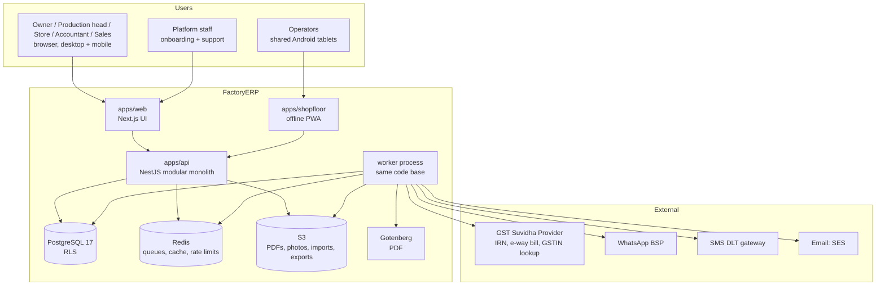
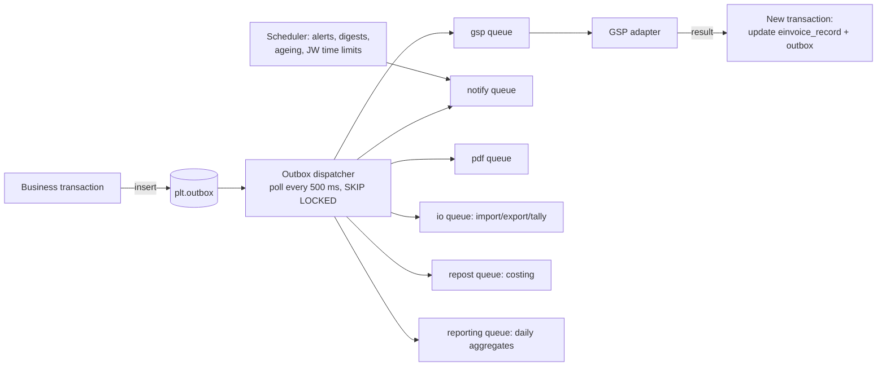
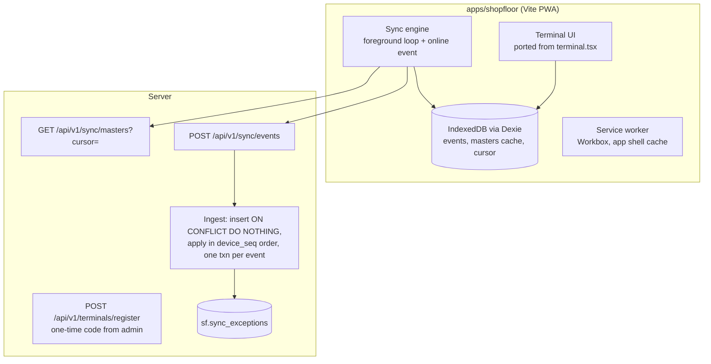
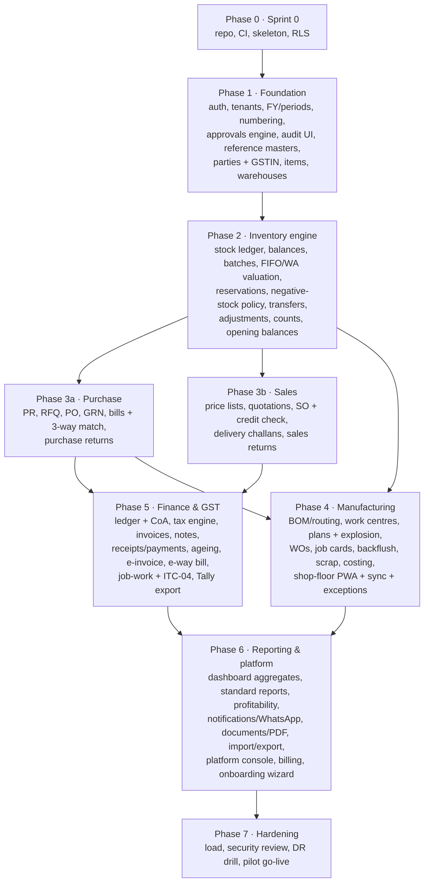

# FactoryERP — Architecture Design and Implementation Kickoff

| | |
| --- | --- |
| **Document** | 01 of the implementation blueprint series |
| **Date** | 4 October 2026 |
| **Inputs** | `test/PRD_ Factory-First Cloud ERP for Indian SMEs.md` (PRD v1.0), `test/FactoryERP_MVP_Architecture.md` (Architecture v1.0, sections 1–13; the file stops partway through §13), `web/` (Next.js mock front end) |
| **Purpose** | Fix the target architecture, the repository layout and the conventions, then give a step-by-step plan for the first four weeks so a team can start building |
| **Next document** | `02-IMPLEMENTATION-BLUEPRINT.md`: feature-by-feature backend and frontend plan, API reference, roadmap with task IDs |

**Labels**

| Label | Meaning |
| --- | --- |
| **[PRD]** | Confirmed requirement in the PRD |
| **[ARCH]** | Decided in the architecture spec |
| **[EXISTS]** | Already in the `web/` code base (mock data only) |
| **[REC]** | Recommendation made in this document; needs team sign-off |
| **[A]** | Assumption to validate |
| **[DECIDE]** | Open decision; must be settled before the dependent work starts |

---

## Contents

1. Starting point: what exists today
2. Architecture decisions (ADR summary)
3. System architecture
4. Repository layout (monorepo)
5. Backend architecture
6. Database foundation
7. Frontend architecture and migration from mock stores
8. Shop-floor (offline) architecture
9. Integrations architecture
10. Security baseline
11. Configuration, environments and infrastructure
12. Engineering conventions
13. Kickoff plan: Sprint 0 (weeks 1–2)
14. First vertical slice: Sprint 1 (weeks 3–4)
15. Build order after the kickoff
16. Team and parallel workstreams
17. Decisions needed before coding

---

## 1. Starting point: what exists today

| Area | State | Evidence |
| --- | --- | --- |
| Requirements | PRD with 97 numbered requirements; 47 are P0/P0-P1 for R1 (day 0–90) | `test/PRD_…md` §7 |
| Architecture | Detailed spec for R1: modular monolith, Postgres row-level security, outbox, offline sync, schema DDL, state machines | `test/FactoryERP_MVP_Architecture.md` |
| Missing spec sections | §14 GST/compliance through §25 (API design, security, ADRs, testing, DevOps, 90-day plan) are listed in the contents but absent | file ends at line 880 inside §13.2 |
| Front end | Next.js 16.3 (App Router), React 19.2, TypeScript, Tailwind v4, Radix UI, cmdk, sonner, recharts, zustand. About 150 routes covering every R1 module, plus HR and a platform (super-admin) console | `web/package.json`, `web/src/app/**` |
| Business logic | Lives in 17 zustand stores (`web/src/lib/store/*.ts`, ~5,400 lines): tax split, 3-way match, BOM explosion and netting, standard vs actual costing, job-work due dates, offline event queue | e.g. `manufacturing.ts` `explodePlan`, `purchase.ts` `lineMatch` |
| Backend | **None.** No API, database, auth, workers or integrations | — |
| Auth and RBAC | Demo role switcher only (`useApp().role`, `ROLES` in `lib/store/app.ts`); enforced in the UI only; no login, sessions or route guards | `lib/store/app.ts` |
| Cross-module consistency | Stores are isolated. The only real cross-store effects are: GRN posting and job-work issue/receipt write inventory movements (called from the pages); receipts reduce invoice balances; delivery → draft invoice; RFQ award → draft PO; PR → PO; two approval types update sales/payments. Delivery, production, scrap, returns, notes, bills and payments do not move stock or post anything; there is no ledger | `sales.ts` `deliver`, `manufacturing.ts` `reportProduction`, `purchase/receipts/[id]/page.tsx` |
| Two master-data sources | Sales, purchase, planning and dashboard read static `lib/data/masters.ts` (`onHand`, `outstanding`, credit limits never change); Inventory has its own `items`/`lots`. Items created in Inventory do not appear in SO/PO pickers | `lib/data/masters.ts`, `lib/store/inventory.ts` |
| Shop-floor link | Terminal events never reach manufacturing job cards; "sync" only flips a status; sync exceptions are seed-only | `terminal.tsx` `useSync`, `shopfloor.ts` |
| Rules that exist only on screen | Lock date and periods, approval rules (except one payment threshold), RBAC matrix and field rules, plan entitlements, impersonation scope and expiry are configured in the UI but enforced nowhere | `settings.ts`, `admin-settings.ts`, `platform.ts` `featureOn` |
| Persistence | Most stores reset on reload; only `useApp` (role, sidebar, lang), `usePlatform` and `useShopfloor` persist to localStorage. "Today" is fixed at 2026-10-02 | `lib/utils.ts` `TODAY` |
| Quality gates | `tsc --noEmit` passes; `eslint` reports 12 errors and 1 warning (`react-hooks/*`); no tests | run on 4 Oct 2026 |
| Version control | The project is not a git repository | — |

**What this means for the plan**

- The UI is the most valuable asset: screens, flows and the "Forge" design system are already reviewed-quality. The backend must be built **to serve these screens**, and the screens must be switched from mock stores to the API one module at a time.
- The pure calculation functions in the stores (tax, matching, explosion, costing, due dates) are worth keeping. They move into a shared, tested `domain` package used by both server and client (§4, §7.4).
- Anything in the stores that writes data (status changes, numbering, stock moves) is throwaway; the server becomes authoritative.

---

## 2. Architecture decisions (ADR summary)

Each decision states what the architecture spec said and what this document recommends. Where they differ, the reason is given.

| # | Decision | Spec said | Recommendation | Why |
| --- | --- | --- | --- | --- |
| ADR-01 | Overall style | Modular monolith [ARCH §7.1] | **Keep.** One deployable `api`, one `worker` process type from the same code | ERP postings need ACID across modules (stock + cost + ledger in one commit). Load is small: ~0.6 production events/s average |
| ADR-02 | Backend language | TypeScript / Node [ARCH] | **Node.js 24 LTS + TypeScript 5 (strict)** | Same language as the front end; shared Zod contracts and domain functions |
| ADR-03 | Backend framework | Not fixed; "controllers, application services, repositories" [ARCH §7.2] | **NestJS 11 on the Fastify adapter** [REC] | Modules, DI, guards and interceptors map directly onto the spec's middleware chain, permission guards and module boundaries; large hiring pool. Fastify for throughput |
| ADR-04 | Data access | Kysely, RLS-scoped connection [ARCH §7.2] | **Kysely + `kysely-codegen`** (types generated from the live schema). No ORM entities | ERP code needs explicit SQL: `FOR UPDATE`, recursive CTEs (BOM cycles), partial indexes, exclusion constraints |
| ADR-05 | Migrations | Forward-only SQL, expand/migrate/contract [ARCH §11.6] | **`dbmate`** with plain `.sql` files | Language-agnostic, reviewable SQL; one binary in CI and Docker |
| ADR-06 | Database | PostgreSQL, shared schema + `tenant_id` + RLS [ARCH §9] | **PostgreSQL 17**, one Postgres schema per module (`inv`, `mfg`, …), RLS forced on every tenant table | As spec |
| ADR-07 | Validation and contracts | Zod, shared `contracts` package [ARCH §7.3] | **Keep.** `packages/contracts` holds request/response schemas; server validates, client types from it | One source of truth for shapes |
| ADR-08 | Events and jobs | Transactional outbox + Redis/BullMQ [ARCH §7.1] | **Keep.** Outbox table written in the business transaction; dispatcher moves rows to BullMQ queues | No lost or phantom events; no Kafka needed in R1 |
| ADR-09 | Web front end | React SPA with TanStack Router [ARCH §7.3] | **Keep the existing Next.js 16 app**, used as a client-rendered app shell; no business logic in Server Actions or Route Handlers | The UI already exists in Next.js; rewriting it into Vite would waste weeks. Next only serves the UI and proxies `/api` |
| ADR-10 | Server state in the UI | TanStack Query [ARCH §7.3] | **TanStack Query v5**; zustand kept only for UI state (sidebar, language, filters, shop-floor device state) | Caching, retries and invalidation are solved problems |
| ADR-11 | Forms | React Hook Form + Zod [ARCH §7.3] | **Keep** | Same schemas as the server |
| ADR-12 | Shop-floor app | Separate light PWA bundle, IndexedDB via Dexie, Workbox [ARCH §7.3, §13] | **Separate Vite PWA `apps/shopfloor`** built in Phase 4, reusing the existing terminal UI. The current `/shopfloor` Next route stays as the demo until then [REC] | <300 KB JS target, full control of the service-worker update rule (update only when the queue is empty, [ARCH §13.2]) |
| ADR-13 | Auth | Password + mandatory 2FA for admins; PIN/QR on terminals [ARCH §5.1] | **Own session auth**: opaque session token in an `httpOnly` cookie, sessions in Postgres (cached in Redis), argon2id passwords, TOTP 2FA. Terminals use a device key + operator PIN | Small surface, no external IdP dependency in R1; SSO can be added in R3 |
| ADR-14 | Same-origin API | Not specified | **Serve the API under `/api` on the web origin** (Next `rewrites` locally, CloudFront path routing in production) [REC] | Cookies stay first-party, no CORS, simpler CSRF story |
| ADR-15 | PDF rendering | Headless Chromium worker, HTML/Handlebars [ARCH FR-PL-07] | **Gotenberg** container (Chromium) called by the `pdf` queue; Handlebars templates | Proven container, no Chromium management in our image |
| ADR-16 | Money and quantities | `numeric`, decimal library [ARCH §11.1] | **`decimal.js`** everywhere money/qty is computed; never JS `number` for posting logic | Existing mock code uses floats; must not leak into the server |
| ADR-17 | Hosting | AWS Mumbai, CloudFront, RDS Multi-AZ, S3 [ARCH §7.1] | **Keep**: ECS Fargate (api, worker, gotenberg), RDS PostgreSQL, ElastiCache Redis, S3, CloudFront + WAF; Terraform | India data residency [PRD §10] |
| ADR-18 | Testing stack | Not in spec (§20 missing) | **Vitest** (unit), **Testcontainers** Postgres/Redis (integration), **Playwright** (E2E), **k6** (load) | Fast, TypeScript-native |
| ADR-19 | Monorepo tooling | Shared packages implied [ARCH §7.3] | **pnpm workspaces + Turborepo** | Shared contracts/domain/ui packages, cached builds |
| ADR-20 | Observability | Sentry mentioned [ARCH §7.3] | **pino** JSON logs, **OpenTelemetry** traces, **Sentry** errors, CloudWatch metrics/alarms | Each log line carries `tenant_id` and `request_id` |

---

## 3. System architecture

### 3.1 Context



### 3.2 Request path (synchronous)

```mermaid
sequenceDiagram
  participant B as Browser (apps/web)
  participant CF as CloudFront /api/*
  participant A as api (NestJS)
  participant DB as PostgreSQL
  B->>CF: POST /api/v1/sales-orders/{id}/confirm<br/>cookie fe_session, Idempotency-Key, If-Match: version
  CF->>A: forward
  A->>A: 1 request id + logger context
  A->>A: 2 authenticate session (Redis cache → sessions table)
  A->>A: 3 resolve tenant + permissions + field rules
  A->>A: 4 rate limit (Redis)
  A->>A: 5 idempotency check
  A->>A: 6 validate body (Zod contract)
  A->>DB: BEGIN; SET LOCAL app.tenant_id, app.user_id
  A->>DB: use case: lock rows, domain logic, writes
  A->>DB: audit_log row + outbox event (same txn)
  A->>DB: COMMIT
  A-->>B: 200 { data } with new version (ETag)
```

### 3.3 Asynchronous path



Rules:
- External calls (GSP, WhatsApp, email) **never** run inside a database transaction [ARCH §11.5].
- Each job carries `tenant_id`; the worker opens its transaction with the same `SET LOCAL app.tenant_id` before touching data.
- Jobs are idempotent (keyed by outbox id) because BullMQ delivers at least once.

---

## 4. Repository layout (monorepo)

The project is not under version control yet. The first kickoff task is `git init` (K-01). Then move the existing `web/` into the workspace unchanged.

```
ERP/
├── apps/
│   ├── web/                      ← existing web/ moved here (git mv), Next.js 16
│   ├── api/                      ← NestJS backend (api + worker entry points)
│   └── shopfloor/                ← Vite PWA (Phase 4)
├── packages/
│   ├── contracts/                ← Zod schemas: requests, responses, enums, permission codes
│   ├── domain/                   ← pure business functions (tax, matching, BOM, costing, dates), decimal.js
│   ├── ui/                       ← (later) Forge primitives shared by web + shopfloor
│   ├── config-eslint/            ← shared lint config + module-boundary rules
│   └── config-ts/                ← shared tsconfig bases
├── db/
│   ├── migrations/               ← dbmate SQL files, forward-only
│   ├── seeds/                    ← reference data (states, UoM, HSN, plans) + industry templates
│   └── schema.sql                ← dbmate dump, committed, reviewed in PRs
├── infra/
│   ├── docker/                   ← Dockerfiles: api, worker, web, shopfloor
│   ├── compose.dev.yml           ← Postgres, Redis, MinIO, Mailpit, Gotenberg, fake GSP
│   └── terraform/                ← AWS ap-south-1 (Phase 6)
├── docs/                         ← this blueprint, ADRs, runbooks
├── test/                         ← existing PRD + architecture docs (kept as is)
├── .github/workflows/            ← CI/CD
├── pnpm-workspace.yaml
├── turbo.json
└── .nvmrc                        ← 24
```

### 4.1 `apps/api` internal layout

One folder per backend module from [ARCH §8]. Every module has the same shape.

```
apps/api/src/
├── main.api.ts                   ← HTTP entry
├── main.worker.ts                ← queues + scheduler entry
├── app.module.ts
├── core/                         ← cross-cutting, no business logic
│   ├── config/                   ← zod-validated env
│   ├── db/                       ← Kysely instance, withTenantTx(), generated types
│   ├── http/                     ← problem+json filter, request-id, idempotency interceptor
│   ├── auth/                     ← session guard, terminal guard, @Can() decorator, field masking
│   ├── audit/                    ← AuditWriter (hash chain)
│   ├── outbox/                   ← OutboxWriter, dispatcher
│   ├── queue/                    ← BullMQ registration, base processor with tenant context
│   ├── numbering/                ← NumberSeriesService (FY series, row lock)
│   ├── money/                    ← decimal helpers (re-export from packages/domain)
│   └── testing/                  ← factories, test tenant builder
└── modules/
    ├── platform/                 ← tenants, companies, plants, FY/periods, entitlements, settings
    ├── identity/                 ← users, roles, permissions, sessions, 2FA, terminals, operators
    ├── workflow/                 ← approval rules + requests
    ├── parties/                  ← customers, vendors, job-workers, addresses, GSTIN
    ├── catalog/                  ← items, variants, UoM, categories, HSN link, price lists
    ├── inventory/                ← warehouses, batches, stock_movements, balances, reservations, counts
    ├── costing/                  ← cost layers, valuation, cost entries, standard cost
    ├── manufacturing/            ← BOM, routing, work centres, WOs, job cards, production entries, scrap
    ├── planning/                 ← production plans, explosion, shortages
    ├── purchase/                 ← PR, RFQ, PO, GRN, bills, purchase returns
    ├── sales/                    ← quotations, SOs, delivery challans, sales returns
    ├── jobwork/                  ← JW challans out/in, ITC-04
    ├── finance/                  ← ledger, invoices, notes, receipts, payments, ageing
    ├── gst/                      ← tax engine, HSN/rates, place of supply, e-invoice, e-way bill
    ├── shopfloor/                ← sync ingest, device sequences, exceptions
    ├── notify/                   ← templates, preferences, outbound messages
    ├── documents/                ← templates, rendering
    ├── data-io/                  ← imports, exports, Tally XML
    ├── reporting/                ← daily aggregates, report definitions, dashboard
    ├── integrations/             ← GSP, BSP, SMS, email, storage adapters
    └── support/                  ← platform console: tenant lookup, consented impersonation
```

Inside each module:

```
modules/sales/
├── sales.module.ts
├── http/                         ← controllers only: parse, authorize, call a use case, map response
│   ├── sales-orders.controller.ts
│   └── quotations.controller.ts
├── application/                  ← use cases; one public method = one transaction
│   ├── confirm-sales-order.ts
│   ├── deliver-sales-order.ts
│   └── sales.service.ts          ← the module's PUBLIC interface for other modules
├── domain/                       ← module-specific pure logic (state machine, rules)
│   └── sales-order.state.ts
├── infra/                        ← Kysely repositories (only place that touches sal.* tables)
│   └── sales-order.repo.ts
├── events.ts                     ← event type definitions this module emits
└── __tests__/
```

**Boundary rule** [ARCH §8]: a module may import another module's `application/*.service.ts` only, never its `infra/` or tables. Reporting is the one read-only exception and reads through SQL views. Enforce this with `dependency-cruiser` in CI (K-14).

---

## 5. Backend architecture

### 5.1 Tenant-scoped transaction (the core primitive)

Every use case runs inside `withTenantTx`. It opens one transaction, sets the RLS context, and gives the use case the audit and outbox writers bound to the same transaction.

```ts
// apps/api/src/core/db/tenant-tx.ts
import { sql, type Transaction } from "kysely";
import type { DB } from "./generated";

export interface TxContext {
  tx: Transaction<DB>;
  tenantId: string;
  actor: { type: "user" | "operator" | "system" | "support"; id: string; terminalId?: string };
  audit: AuditWriter;
  outbox: OutboxWriter;
}

export async function withTenantTx<T>(
  db: Kysely<DB>,
  ctx: { tenantId: string; actor: TxContext["actor"]; requestMeta: RequestMeta },
  fn: (c: TxContext) => Promise<T>,
): Promise<T> {
  return db.transaction().execute(async (tx) => {
    // SET LOCAL is transaction-scoped, so it is safe with PgBouncer transaction pooling.
    await sql`select set_config('app.tenant_id', ${ctx.tenantId}, true),
                     set_config('app.actor_id',  ${ctx.actor.id},  true)`.execute(tx);
    const c: TxContext = {
      tx,
      tenantId: ctx.tenantId,
      actor: ctx.actor,
      audit: new AuditWriter(tx, ctx),
      outbox: new OutboxWriter(tx, ctx.tenantId),
    };
    return fn(c);
  });
}
```

The application connects as `app_user`, which has no `BYPASSRLS` and does not own the tables. If a developer forgets `withTenantTx`, every query returns zero rows instead of leaking data. That is the intended failure mode.

### 5.2 A use case, end to end

```ts
// modules/sales/application/confirm-sales-order.ts
export class ConfirmSalesOrder {
  constructor(
    private db: Kysely<DB>,
    private repo: SalesOrderRepo,
    private parties: PartiesService,      // public interface of another module
    private workflow: WorkflowService,
    private inventory: InventoryService,
  ) {}

  async execute(req: AuthedRequest, id: string, expectedVersion: number) {
    return withTenantTx(this.db, req.ctx, async (c) => {
      const so = await this.repo.getForUpdate(c.tx, id);              // SELECT … FOR UPDATE
      assertVersion(so, expectedVersion);                              // 412 on mismatch
      assertTransition(so.status, "confirmed");                        // state machine, 409 if illegal

      const totals = computeDocumentTotals(so.lines, so.placeOfSupply); // packages/domain, decimal.js
      const exposure = await this.parties.creditExposure(c, so.customerId);
      const needsApproval =
        exposure.plus(totals.total).gt(exposure.limit) ||
        (await this.workflow.matches(c, "sales_order", { discountPct: so.maxDiscountPct, total: totals.total }));

      if (needsApproval) {
        await this.workflow.request(c, { docType: "sales_order", docId: id, reason: "credit_or_discount" });
        await this.repo.setStatus(c.tx, id, "pending_approval");
      } else {
        await this.inventory.reserveForSalesOrder(c, so);             // [ARCH G11]
        await this.repo.setStatus(c.tx, id, "confirmed");
      }

      await c.audit.write({ action: "confirm", entity: "sales_order", id, before: so, after: { status: … } });
      await c.outbox.emit("SalesOrderConfirmed", id, { needsApproval });
      return this.repo.get(c.tx, id);
    });
  }
}
```

The pattern is the same for every posting: **lock → check version → check transition → compute with domain functions → write → audit → outbox → commit**.

### 5.3 Controller, permission and field masking

```ts
// modules/sales/http/sales-orders.controller.ts
@Controller("v1/sales-orders")
export class SalesOrdersController {
  @Post(":id/confirm")
  @Can("sales.order.confirm")                       // checked by PermissionGuard against the session's role set
  @Idempotent()                                     // requires Idempotency-Key, replays the stored response
  async confirm(@Req() req: AuthedRequest, @Param("id", UuidPipe) id: string, @Headers("if-match") v: string) {
    const so = await this.confirmSo.execute(req, id, parseVersion(v));
    return present(SalesOrderResponse, so, req.ctx.fieldRules);   // masks cost/rate/margin per role [ARCH §5.2]
  }
}
```

- **Permission codes** follow `module.resource.action` [ARCH §5.2]; the full list lives in `packages/contracts/src/permissions.ts` so the UI and server share it.
- **Field rules** are applied in `present()`: restricted fields are removed from the JSON, not just hidden in the UI. The existing `seesCost` flag in `lib/store/app.ts` becomes the field rule `{ fields: ["cost","rate","margin","value"], mode: "hidden" }` on the Store keeper and Sales roles.
- **Segregation of duties** [ARCH §5.2]: `WorkflowService.decide()` rejects a decision when `decided_by = requested_by`, unless the tenant has turned this off.

### 5.4 Error model

All errors are RFC 9457 `application/problem+json`, with a stable `code` the UI maps to messages:

```json
{
  "type": "https://errors.factoryerp.in/credit-limit-exceeded",
  "title": "Credit limit exceeded",
  "status": 409,
  "code": "SALES.CREDIT_LIMIT_EXCEEDED",
  "detail": "Exposure ₹16.24 L exceeds limit ₹15.00 L",
  "errors": [{ "path": "lines[0].qty", "code": "QTY_EXCEEDS_PENDING", "message": "…" }],
  "requestId": "01J…"
}
```

| HTTP | When |
| --- | --- |
| 400 | Body or query fails the Zod contract |
| 401 | No or expired session / terminal token |
| 403 | Missing permission, entitlement (`PLAN.FEATURE_NOT_INCLUDED`) or scope |
| 404 | Not found **in this tenant** (never reveal other tenants' ids) |
| 409 | Illegal state transition, business-rule violation, duplicate |
| 412 | `If-Match` version mismatch (someone else changed the document) |
| 422 | Document valid in shape but fails posting rules (e.g. period locked, negative stock blocked) |
| 429 | Rate limited |
| 502/503 | Integration down (only from integration status endpoints; postings never wait on integrations) |

### 5.5 Idempotency and concurrency

- `POST` actions that create or post documents require an `Idempotency-Key` header. The key, request hash and response are stored in `plt.idempotency_keys` for 24 hours; a replay returns the stored response.
- Every document row has `version int`; updates use `where version = $expected`; the response returns the new version in `ETag`.
- Stock postings lock `inv.stock_balances` rows **sorted by key** to avoid deadlocks [ARCH §11.5]; number allocation locks the `plt.number_series` row.

### 5.6 Document numbering

- Formats follow what the UI already shows [EXISTS]: `SO-2026-00231`, `INV/26-27/0412`, `DC/26-27/0388`, `JWC/26-27/0034`, `GRN-2026-00123`.
- Numbers come from `plt.number_series (tenant_id, gstin_id, fiscal_year_id, series_code)` with `next_number`, allocated with `SELECT … FOR UPDATE` inside the posting transaction.
- **GST documents (invoice, credit/debit note, delivery challan, JW challan) get their number at posting, not at draft.** The mock assigns invoice numbers at draft (`finance.ts` `createInvoiceFromDelivery`). This must change, because deleted drafts would leave gaps in a series that must be sequential per FY [ARCH G5, VERIFY with CA].
- Drafts show a temporary reference such as `Draft #7f3a`.

### 5.7 Audit log

- `aud.audit_log`, monthly partitions, insert-only grants, per-tenant hash chain: `hash = sha256(prev_hash || canonical_json(row))` [ARCH §11.2].
- Written by `AuditWriter` in the same transaction as the change. To keep the chain consistent under concurrency, take `pg_advisory_xact_lock(hashtext(tenant_id))` before reading `prev_hash`. Audit writes then serialize per tenant, which is acceptable at the expected volume.
- The mock in `lib/store/admin.ts` [EXISTS] is **not reusable as is**. Its `hash()` is a 32-bit FNV-style mix, not SHA-256, and `verifyChain()` only checks that each `prevHash` equals the previous `hash`; it never recomputes hashes, so edited content would pass. Re-implement it in `packages/domain/audit` with SHA-256 over canonical JSON and full recomputation. Add a server endpoint `GET /api/v1/audit/verify?from&to`. Today no action writes audit entries (the log is static seed data); on the server every use case writes one through `AuditWriter`.

### 5.8 Outbox and workers

```sql
-- plt.outbox (from ARCH §11.2)
create table plt.outbox (
  id            bigint generated always as identity primary key,
  tenant_id     uuid not null,
  event_type    text not null,
  aggregate_id  uuid not null,
  payload       jsonb not null,
  created_at    timestamptz not null default now(),
  dispatched_at timestamptz
);
create index outbox_pending on plt.outbox (created_at) where dispatched_at is null;
```

Dispatcher loop (worker process):

```sql
with batch as (
  select id from plt.outbox
  where dispatched_at is null
  order by id
  limit 200
  for update skip locked
)
update plt.outbox o set dispatched_at = now()
from batch where o.id = batch.id
returning o.*;
```

The dispatcher runs as the `app_dispatcher` role (allowed to read `plt.outbox` across tenants, nothing else). It maps `event_type` to one or more queues (table in `core/outbox/routes.ts`). Each processor extends `TenantJobProcessor`, which opens `withTenantTx` with the job's tenant.

### 5.9 Entitlements

- Tables `plt.plans`, `plt.plan_features`, `plt.tenant_entitlements` [ARCH §9.5].
- `@RequireFeature("jobwork")` on controllers; `LimitService.check("office_users")` on user invite and terminal registration. Operators never count against user limits [PRD §13].
- The front end reads `/api/v1/me` → `entitlements` to hide or upsell modules. The existing `PLANS` and `FEATURES` in `lib/store/platform.ts` [EXISTS] become seed data.
- [DECIDE] Prices and limits differ in three places:
  - PRD: Starter ₹2,999, 5 office users.
  - `lib/store/platform.ts`: Starter ₹7,900, 3 users; Growth 5 users.
  - The tenant pages: `settings/billing/page.tsx` has its own local `PLANS` copy with different rounding, and `settings.ts` has `officeUserLimit: 10`.

  On the server there is one source: `plt.plans` seeded with whatever the business confirms. Today `featureOn()` has no callers, so nothing in the tenant app is gated by plan.

### 5.10 Logging and tracing

- pino logger with `request_id`, `tenant_id`, `actor_id`, `route`, `duration_ms`. Never log request bodies of auth endpoints, PINs, GSP credentials or full GSTIN/PAN lists.
- OpenTelemetry auto-instrumentation for HTTP, pg, ioredis, BullMQ; export to an OTLP collector (CloudWatch/X-Ray or Grafana Cloud).
- Sentry for unhandled errors in api, worker, web and shopfloor, tagged with `tenant_id` (not names).

---

## 6. Database foundation

### 6.1 Schemas and ownership

| Postgres schema | Module | Examples |
| --- | --- | --- |
| `plt` | platform | tenants, companies, gstins, plants, fiscal_years, periods, number_series, plans, entitlements, settings, outbox, idempotency_keys |
| `idn` | identity | users, memberships, roles, role_permissions, field_rules, sessions, totp, terminals, operators |
| `aud` | audit | audit_log |
| `wf` | workflow | approval_rules, approval_requests |
| `pty` | parties | parties, party_addresses, party_gstins, party_contacts |
| `cat` | catalog | items, item_uoms, item_categories, uoms, price_lists, price_list_items |
| `gst` | gst | hsn_codes, tax_rates, states, einvoice_records, eway_bills |
| `inv` | inventory | warehouses, batches, stock_movements, stock_balances, reservations, count_sessions, adjustments |
| `cst` | costing | cost_layers, cost_layer_consumptions, cost_entries, standard_costs |
| `mfg` | manufacturing | boms, bom_lines, bom_outputs, routings, routing_operations, work_centres, work_orders, job_cards, production_entries, scrap_entries |
| `pln` | planning | production_plans, plan_lines, plan_shortages |
| `pur` | purchase | requisitions, rfqs, rfq_quotes, purchase_orders, po_lines, grns, grn_lines, purchase_bills, bill_lines, purchase_returns |
| `sal` | sales | quotations, sales_orders, so_lines, delivery_challans, dc_lines, sales_returns |
| `jw` | jobwork | challans_out, challan_out_lines, receipts_in, receipt_in_lines |
| `fin` | finance | accounts, account_mappings, journals, ledger_entries, invoices, invoice_lines, notes, receipts, payments, allocations |
| `sf` | shopfloor | sync_events, device_cursors, sync_exceptions, shifts |
| `ntf` | notify | templates, preferences, messages |
| `doc` | documents | templates, rendered_files |
| `dio` | data-io | import_jobs, import_rows, export_jobs, tally_runs |
| `rpt` | reporting | daily_production, daily_sales, daily_cash, report_definitions |
| `hr` | people (see [DECIDE] in §17) | employees, attendance, rosters, leave, payroll_inputs |

### 6.2 Table conventions [ARCH §11.1]

```sql
-- Every tenant-owned table starts like this
tenant_id   uuid        not null,
id          uuid        not null default uuidv7(),   -- PG17: use pg_uuidv7 extension or app-generated
created_at  timestamptz not null default now(),
created_by  uuid        not null,
updated_at  timestamptz not null default now(),
updated_by  uuid        not null,
version     int         not null default 1,
primary key (tenant_id, id)
```

- Money `numeric(18,2)`, rates `numeric(18,4)`, quantities `numeric(18,4)`, unit costs `numeric(20,6)`.
- Foreign keys are composite and include `tenant_id`: `foreign key (tenant_id, item_id) references cat.items (tenant_id, id)`.
- Masters use `archived_at` for soft delete. Transactions are never deleted.
- Posted documents are protected by a trigger that rejects `UPDATE`/`DELETE` when `status` is a posted state.

### 6.3 RLS template (applied to every tenant table by a helper)

```sql
-- db/migrations/20261005000002_rls_helpers.sql
create or replace function plt.enable_tenant_rls(tbl regclass) returns void
language plpgsql as $$
begin
  execute format('alter table %s enable row level security', tbl);
  execute format('alter table %s force row level security', tbl);
  execute format($p$
    create policy tenant_isolation on %s
      using (tenant_id = current_setting('app.tenant_id', true)::uuid)
      with check (tenant_id = current_setting('app.tenant_id', true)::uuid)
  $p$, tbl);
  execute format('grant select, insert, update, delete on %s to app_user', tbl);
end $$;

-- Append-only tables get INSERT/SELECT only:
create or replace function plt.make_append_only(tbl regclass) returns void
language plpgsql as $$
begin
  execute format('revoke update, delete on %s from app_user', tbl);
end $$;
```

Each migration that creates a table calls `select plt.enable_tenant_rls('inv.stock_movements'); select plt.make_append_only('inv.stock_movements');`. A CI check (K-15) fails the build if any table with a `tenant_id` column lacks a policy.

### 6.4 Database roles

| Role | Used by | Rights |
| --- | --- | --- |
| `app_owner` | migrations only | owns all objects |
| `app_user` | api + worker | DML on tenant tables, subject to RLS; no `BYPASSRLS` |
| `app_dispatcher` | outbox dispatcher | `select, update(dispatched_at)` on `plt.outbox` (outbox has no RLS) |
| `app_support` | support console reads | `BYPASSRLS` **only** through security-definer functions that check an active, tenant-granted support grant and write to `aud.audit_log` |
| `app_readonly` | analytics/BI (later) | read on reporting views |

### 6.5 First migrations (Sprint 0–1)

| File | Contents |
| --- | --- |
| `…01_extensions.sql` | `pgcrypto`, `pg_trgm`, `btree_gist`, `citext`, `pg_uuidv7` (or app-side UUIDv7) |
| `…02_roles_and_helpers.sql` | roles above, `plt.enable_tenant_rls`, `plt.make_append_only`, `plt.touch_updated_at` trigger, posted-row guard trigger |
| `…03_platform.sql` | `plt.tenants`, `companies`, `gstins`, `plants`, `fiscal_years`, `periods` (open/closed/locked), `lock_dates`, `number_series`, `settings`, `plans`, `plan_features`, `tenant_entitlements`, `outbox`, `idempotency_keys` |
| `…04_identity.sql` | `idn.users` (global; `email citext unique`, argon2 hash), `memberships (tenant_id, user_id, status)`, `roles`, `role_permissions`, `user_roles`, `field_rules`, `role_scopes`, `sessions`, `totp_secrets`, `recovery_codes`, `invitations`, `terminals`, `operators` |
| `…05_audit.sql` | `aud.audit_log` partitioned by month, first 3 partitions, partition-maintenance function |
| `…06_reference.sql` | `gst.states`, `cat.uoms`, `gst.hsn_codes`, `gst.tax_rates` (with `exclude using gist (hsn_id with =, daterange(effective_from, effective_to) with &&)`), `plt.payment_terms`, reason codes |
| `…07_parties.sql` | `pty.parties`, `party_addresses`, `party_gstins`, `party_contacts` |
| `…08_catalog.sql` | `cat.item_categories`, `items`, `item_uoms`; trigger making `valuation_method` immutable after the first stock movement (enforced later when `inv` exists) |
| `…09_inventory_core.sql` | `inv.warehouses`, `batches`, `stock_movements`, `stock_balances`, `reservations` |

Users are global (one login can belong to several tenants, e.g. an external CA serving several factories [ARCH §5.1]); everything a user can do is resolved through `memberships` + `user_roles` **per tenant**.

### 6.6 Seed data

- **Reference (global):** Indian states and codes, UoMs, HSN chapters with current GST rates, plans and features.
- **Industry templates** [ARCH §9.4]: versioned JSON bundles (`db/seeds/templates/cnc_job_shop.v1.json` …) applied by an idempotent `TemplateSeeder`: roles, default chart of accounts, reason codes, warehouses (RMS, WIP, FGS, QCH, SCR), number series, document templates, approval rules, shifts. The names in the existing `TEMPLATES` constant (`lib/store/platform.ts`) [EXISTS] are the starting list.
- **Demo tenant:** port `lib/data/masters.ts` (Shakti Precision) and the store seeds into a `demo` seed so the UI looks the same against the real API as it does against the mocks. This makes the screen-by-screen switch-over easy to verify.

---

## 7. Frontend architecture and migration from mock stores

### 7.1 Target structure inside `apps/web/src`

```
src/
├── app/                          ← existing routes, unchanged paths
├── components/                   ← existing Forge components (ui/, erp/, shell/, <domain>/)
├── features/                     ← NEW: one folder per backend module
│   └── sales/
│       ├── api.ts                ← typed fetchers using packages/contracts
│       ├── queries.ts            ← TanStack Query hooks: useSalesOrders(), useSalesOrder(id), useConfirmSalesOrder()
│       ├── keys.ts               ← query key factory, includes tenantId
│       └── mock.ts               ← adapter over the old zustand store (during migration only)
├── lib/
│   ├── api/                      ← fetch client: base URL, credentials, Idempotency-Key, problem+json → ApiError
│   ├── auth/                     ← useMe(), useCan(), <Can>, entitlements
│   ├── store/                    ← existing mock stores (deleted module by module)
│   └── utils.ts                  ← INR/date/amount-in-words helpers (move pure parts to packages/domain)
└── proxy.ts                      ← NEW: optimistic auth redirect (Next 16 renamed middleware → proxy)
```

### 7.2 Data flow

```mermaid
flowchart LR
  P[Page component<br/>app/(erp)/sales/orders/[id]/page.tsx] --> H[useSalesOrder(id)<br/>features/sales/queries.ts]
  H --> C[apiClient.get<br/>lib/api]
  C -->|/api/v1/sales-orders/:id| N[Next rewrite / CloudFront]
  N --> API[apps/api controller] --> UC[use case] --> DB[(Postgres)]
  API -->|JSON, fields masked by role| C --> H --> P
  P -->|button: Confirm| M[useConfirmSalesOrder()<br/>mutation + Idempotency-Key + If-Match]
  M --> C
  M -->|onSuccess| INV[invalidate keys:<br/>sales-order id, list, approvals, dashboard]
```

### 7.3 Switching from mocks to the API, one module at a time

The pages today read stores directly, e.g. `useSales((s) => s.orders)`. To avoid a big-bang rewrite:

1. For a module, write `features/<module>/queries.ts` with hooks whose **return shape matches what the page needs** (`{ data, isLoading, error }`).
2. Implement each hook twice behind a flag: `mock.ts` wraps the zustand store, `api.ts` calls the server. The flag is `NEXT_PUBLIC_DATA_SOURCE_<MODULE>=mock|api`.
3. Change the page to use the hook. With the flag on `mock`, the screen must look and behave exactly as before. That is the first review.
4. Build the backend endpoints; flip the flag to `api`; run the module's Playwright flows.
5. When stable in staging, delete the module's mock store and `mock.ts`.

Order of switch-over follows the backend build order (§15). Cross-module pages (dashboard, approvals, reports) switch last.

### 7.4 Moving business logic out of the stores

These existing functions are correct in intent and should be moved, not rewritten, into `packages/domain` with `decimal.js` and explicit inputs (no `itemById` lookups inside):

| Existing function | File | New home | Changes needed |
| --- | --- | --- | --- |
| `lineTaxable`, `soTotals` | `lib/store/sales.ts` | `domain/gst/document-totals.ts` | Decimal; per-line GST rounding to 2 decimals (needed for e-invoice line values); place of supply from ship-to address, not only party state |
| `invTotals` (with HSN summary), `payStatus`, `balanceDue`, `isOverdue` | `lib/store/finance.ts` | `domain/gst`, `domain/finance` | Same; `TODAY` becomes a parameter |
| `taxSplit`, `lineMatch`, `billMatched`, `TOLERANCE` | `lib/store/purchase.ts` | `domain/purchase/three-way-match.ts` | Tolerances become tenant settings |
| `explodePlan`, `flatten`, `stdCost`, `woRequired`, `woCosting`, `activeBomFor` | `lib/store/manufacturing.ts` | `domain/manufacturing/*` | Remove hardcoded `ON_ORDER`, ₹6.5/₹6.8 job-work charges and the `* 1.02` markup; take stock, open POs and rates as inputs |
| `dueDate`, `pendingQty`, `challanState`, `isInterstate` | `lib/store/jobwork.ts` | `domain/jobwork/time-limits.ts` | Alert lead time from settings |
| `netRate`, `validity` | `lib/store/pricelists.ts` | `domain/pricing` | — |
| `quoteTotal`, `lowestVendor` | `lib/store/rfq.ts` | `domain/purchase/rfq.ts` | — |
| `returnValue`, `EWB_THRESHOLD` | `lib/store/returns.ts` | `domain/gst/eway.ts` | Threshold from config (rules change) |
| `freeQty`, `stockByItem` | `lib/store/inventory.ts` | server SQL views instead | — |
| `verifyChain` | `lib/store/admin.ts` | `domain/audit/hash-chain.ts` | Rewrite: SHA-256 over canonical JSON and recompute every hash (the mock only checks links) |
| INR format, Indian grouping, FY, amount in words | `lib/utils.ts` | `domain/format` | — |

The server is always authoritative. The client uses the same functions only to show live previews (totals while typing a line). Each moved function gets unit tests first (golden values from the current mock data), so the move is verified.

### 7.5 Authentication in the web app

- `proxy.ts` (Next 16): if there is no `fe_session` cookie, redirect to `/login?next=…`. This is an optimistic check only; Next's docs say Proxy must not be the authorization layer, and the API remains the real gate.
- `useMe()` loads `/api/v1/me` once: user, active tenant, roles, `permissions[]`, `fieldRules`, `entitlements`, language.
- Replace the demo role switcher in `lib/store/app.ts`:
  - `role.modules` → derived from permissions (`sales.*` visible ⇒ Sales module visible) **and** entitlements.
  - `role.seesCost` → `useFieldVisible("item.cost")`.
  - `role.approves` → `useCan("workflow.approval.decide")`.
- `<Can perm="…">` wrapper and `useCan()` hook for buttons; nav (`lib/nav.ts`) is filtered by the same check.
- Keep a **"view as role" demo mode** only for the demo tenant (support/sales demos), driven by a server-issued demo session, not by client state.

### 7.6 UI states and conventions

- Every list and form page handles: loading (skeleton matching the Forge table/form), empty (with the primary action), error (problem+json `title`, retry), forbidden (403 page), not found, and stale version (412: "This document changed — reload").
- Mutations show sonner toasts on success; field errors from `errors[]` map onto React Hook Form fields by `path`.
- Lists use server-side pagination, sort and filters. The existing `ControlPanel` facets map onto query parameters (`?status=confirmed&customer=…&q=…&cursor=…`).
- Accessibility and responsiveness: keep the Forge rules (32 px controls, 56 px touch targets on shop floor). Dashboard, approvals and stock count stay mobile-first [ARCH §7.3].

### 7.7 Internationalisation

- Web: ICU messages with `next-intl` or FormatJS [REC: FormatJS to match the shop-floor app], locales `en-IN` and `hi-IN` [PRD FR-PL-05].
- The shop-floor dictionary in `components/shopfloor/i18n.ts` [EXISTS] becomes the first `hi-IN` catalog.
- Master data carries `name_hi` [ARCH G19]; the API returns both names, and the UI picks by locale.

---

## 8. Shop-floor (offline) architecture

Based on [ARCH §13] and the existing terminal (`components/shopfloor/terminal.tsx`, `lib/store/shopfloor.ts`), which already models append-only events, UUIDv7 ids and a gap-free device sequence.

### 8.1 Components



### 8.2 Terminal identity and operator login

1. Admin creates a terminal in **Settings → Terminals & operators** [EXISTS UI] and gets a one-time registration code (valid 15 minutes).
2. The tablet calls `POST /terminals/register` with the code; the server returns a **device key** (random 256-bit), stored by the tablet; the server stores only its hash.
3. Every sync request carries `Authorization: Terminal <terminal_id>.<signature>` where the signature is an HMAC of the body with the device key.
4. Operator PIN check happens **on the device** when offline [ARCH §13.1]. The masters delta includes, per operator, `pin_hash = argon2id(pin, salt=terminal_pepper ‖ operator_id)`.
   - Risk: 4-digit PINs are brute-forceable from a stolen tablet. Mitigations: per-terminal pepper (rotating with the device key), lock the terminal UI after 5 wrong PINs, revoke the terminal remotely (`revoked_at`), and **re-verify on the server** — every event carries `operator_id` and the server rejects events from revoked terminals or deactivated operators into exceptions. Operator scope is limited to job events, so the residual risk is acceptable [REC; needs security sign-off].
   - QR badge login (FR-SF-07) uses `badge_secret_hash` the same way.

### 8.3 Sync protocol

- `GET /sync/masters?cursor=…` returns job cards for the terminal's work centres, items (with photos and Hindi names), reason codes, operators (+PIN hashes), shifts, and a new cursor.
- `POST /sync/events` with up to 100 events in `device_seq` order. Per event the response returns `applied | duplicate | exception{code}`.
- Server rules [ARCH §13.2]: `event_id` primary key and `unique (terminal_id, device_seq)`; gaps hold later events until the missing one arrives or a timeout moves them to exceptions; `device_time` bounded (not in the future, not older than the configured limit); clock drift recorded per sync.
- Exception codes already modelled in the UI [EXISTS `manufacturing.ts`]: `QTY_OVER_RELEASED`, `WO_CLOSED`, `SEQ_GAP`, `CLOCK_DRIFT`. Resolutions: apply anyway, void, reassign to another job card (Sync exceptions page exists).
- Applying a `qty_report` event runs the full production posting in one transaction: production entry, job-card quantities, backflush issues, FG receipt, scrap, cost layers, cost entries, WIP ledger, audit, outbox [ARCH §11.5].
- Service worker updates only when the event queue is empty; events carry `schema_version`.

---

## 9. Integrations architecture

All providers sit behind interfaces in `modules/integrations`, with a **fake implementation for local/dev/test** and a real adapter per vendor. Credentials are stored per tenant, encrypted (AWS KMS envelope encryption), never returned by the API.

| Port | Interface methods | R1 adapters | Fake for dev |
| --- | --- | --- | --- |
| `GstProvider` | `generateIrn`, `cancelIrn`, `getIrn`, `generateEwayBill`, `updateEwayVehicle`, `cancelEwayBill`, `lookupGstin` | One GSP [DECIDE vendor] | `fake-gsp` HTTP container: deterministic IRN, configurable failure rate and latency |
| `WhatsAppProvider` | `sendTemplate`, `sendDocument`, status webhook | One BSP [DECIDE vendor] | Logs to Mailpit-like inbox UI |
| `SmsProvider` | `send` (DLT template id) | DLT-registered gateway | Console |
| `EmailProvider` | `send` (with attachment) | AWS SES | Mailpit |
| `ObjectStorage` | `put`, `getSignedUrl`, `delete` | S3 | MinIO |
| `PdfRenderer` | `render(html) → pdf` | Gotenberg | Gotenberg (same) |

Rules:
- Calls happen only in workers, with timeouts, exponential back-off with jitter, a circuit breaker per provider, and a per-tenant rate limit.
- Every request/response is stored (redacted) in an `integration_calls` table for support and for the visible retry queue [PRD US-4].
- Webhooks (BSP delivery status, GSP callbacks if any) enter through `POST /api/v1/webhooks/<provider>` with signature verification and are processed via the outbox.

---

## 10. Security baseline

| Area | Requirement | Implementation |
| --- | --- | --- |
| Tenant isolation | Strict [PRD FR-PL-01] | RLS forced on every table; composite FKs; isolation test suite in CI that creates two tenants and asserts zero cross-tenant rows from every endpoint and table |
| Authentication | 2FA mandatory for Owner/Admin and Accountant [ARCH §5.1] | argon2id; TOTP with recovery codes; login rate limits per IP and per account; session rotation on login and privilege change; idle timeout 12 h, absolute 30 days [REC] |
| Sessions | Cookie | `fe_session`: `HttpOnly; Secure; SameSite=Lax; Path=/`; stored hashed |
| CSRF | Same-origin API | `SameSite=Lax` plus a required custom header (`X-Requested-With: fe`) on non-GET requests |
| Authorization | Server-side only [ARCH §5.2] | `@Can()` guard, scope filters, field masking in serializers; UI checks are cosmetic |
| Support access | Consent + audit [ARCH G17] | Tenant admin grants time-boxed access (UI exists under Settings → Support access); impersonation sessions are read-only by default, banner in UI, every action audited with `actor_type = support` |
| Secrets | — | AWS Secrets Manager; GSP/BSP credentials per tenant encrypted with KMS |
| Data in transit / at rest | [PRD §10] | TLS 1.2+ everywhere; RDS and S3 encryption; S3 keys prefixed `tenants/{tenant_id}/` with presigned URLs ≤ 5 minutes |
| Input handling | — | Zod on every request; file uploads type-sniffed and size-limited; CSV/Excel imports parsed in workers, never in the API process |
| Headers | — | CSP (Next docs: `content-security-policy` guide), HSTS, `X-Content-Type-Options`, frame-ancestors none |
| Dependency hygiene | — | Renovate, `pnpm audit` in CI, lockfile committed |
| Backups | PITR, daily [PRD §10] | RDS PITR (35 days), cross-region snapshot copy, nightly per-tenant logical export to S3 [ARCH §9.6] |
| Personal data | DPDP Act review [PRD §10, not researched] | Data inventory of personal fields (users, operators, employees, party contacts) before go-live [DECIDE: legal review] |

---

## 11. Configuration, environments and infrastructure

### 11.1 Environments

| Env | Purpose | Data |
| --- | --- | --- |
| `local` | Developer machine, `docker compose -f infra/compose.dev.yml up` | Demo seed |
| `dev` | Every merge to `main` auto-deploys | Demo seed, reset nightly |
| `staging` | Release candidates, pilot rehearsal, load tests | Anonymised copy of pilot data |
| `prod` | Customers | Real |
| `sandbox` | Per-industry training tenants [ARCH S8] | Template seed, reset weekly |

### 11.2 Environment variables (api/worker)

All validated with Zod at startup; the process exits if any is missing.

| Variable | Example | Notes |
| --- | --- | --- |
| `NODE_ENV` | `production` | |
| `APP_ENV` | `local` / `dev` / `staging` / `prod` | |
| `DATABASE_URL` | `postgres://app_user:…@pgbouncer:6432/factoryerp` | `app_user` role |
| `DATABASE_MIGRATOR_URL` | `postgres://app_owner:…` | CI/migration job only |
| `REDIS_URL` | `redis://redis:6379` | |
| `S3_BUCKET`, `S3_ENDPOINT`, `S3_REGION` | `fe-dev-docs`, MinIO URL locally | |
| `SESSION_SECRET` | 64 random bytes | Rotated with dual-key support |
| `KMS_KEY_ID` | | Integration credential encryption |
| `GOTENBERG_URL` | `http://gotenberg:3000` | |
| `GSP_MODE` | `fake` / `sandbox` / `live` | Per environment |
| `WHATSAPP_MODE`, `SMS_MODE`, `EMAIL_MODE` | `fake` / `live` | |
| `SENTRY_DSN`, `OTEL_EXPORTER_OTLP_ENDPOINT` | | |
| `PUBLIC_WEB_ORIGIN` | `https://app.factoryerp.in` | Cookie and CSP origin |

Web: `NEXT_PUBLIC_API_BASE=/api`, `NEXT_PUBLIC_DATA_SOURCE_<MODULE>`, `NEXT_PUBLIC_SENTRY_DSN`, `API_INTERNAL_URL` (rewrite target).

### 11.3 Local development stack (`infra/compose.dev.yml`)

| Service | Image | Port |
| --- | --- | --- |
| postgres | `postgres:17` | 5432 |
| pgbouncer | `edoburu/pgbouncer` (transaction mode) | 6432 |
| redis | `redis:7` | 6379 |
| minio | `minio/minio` | 9000/9001 |
| mailpit | `axllent/mailpit` | 8025 |
| gotenberg | `gotenberg/gotenberg:8` | 3001 |
| fake-gsp | built from `infra/docker/fake-gsp` | 4010 |

Developers run `api`, `worker` and `web` on the host with `pnpm dev` (Turborepo runs all three).

### 11.4 Production topology (AWS ap-south-1)

- CloudFront + WAF → S3 (shopfloor static assets) and ALB.
- CloudFront path routing: `/api/*` → ALB → ECS service `api`; everything else → ECS service `web` (Next.js standalone output).
- ECS services: `api` (2+ tasks), `worker` (2+ tasks), `gotenberg` (1–2 tasks, internal only).
- RDS PostgreSQL 17 Multi-AZ + RDS Proxy or PgBouncer sidecar; ElastiCache Redis (Multi-AZ); S3 with versioning; Secrets Manager; KMS.
- Second region (ap-south-2, Hyderabad) for snapshot and S3 replication.
- Terraform modules in `infra/terraform`, one workspace per environment.

### 11.5 CI/CD (GitHub Actions)

| Stage | Steps | Gate |
| --- | --- | --- |
| PR | install (pnpm, cache) → lint → typecheck → unit tests → dependency-cruiser boundaries → migration lint (no destructive change without the contract phase) → integration tests (Testcontainers) → tenant-isolation suite → build | All green |
| main | build images → push ECR → run migrations (`dbmate up` as a one-off ECS task) → deploy `dev` → Playwright smoke | Smoke green |
| release tag | deploy `staging` → full Playwright suite + k6 smoke → manual approval → deploy `prod` (rolling) | Approval |

---

## 12. Engineering conventions

| Topic | Convention |
| --- | --- |
| Branching | Trunk-based; short-lived feature branches; squash merge; Conventional Commits |
| Code review | Every PR touching posting logic (stock, cost, ledger, GST) needs a second reviewer who knows the domain |
| API paths | `/api/v1/<plural-resource>`, kebab-case; actions as `POST /<resource>/{id}/<verb>` (`/confirm`, `/post`, `/cancel`, `/approve`) |
| Lists | Cursor pagination `?cursor=&limit=` (max 200); filters as query params; `?sort=-date`; response `{ data: [...], meta: { nextCursor, total? } }` |
| Single resources | `{ data: {...} }` + `ETag: "<version>"` |
| Dates | `date` for business dates (`YYYY-MM-DD`), `timestamptz` ISO-8601 for instants; display `DD-MM-YYYY` in IST |
| Money in JSON | Strings with 2 decimals (`"421260.00"`) to avoid float loss; quantities as strings with up to 4 decimals |
| IDs | UUIDv7 everywhere; document numbers are display fields, never keys |
| Events | `PastTense` names (`InvoicePosted`), payload carries ids not full documents, `schema_version` |
| Tests | Co-located `__tests__`; every use case has an integration test against real Postgres |
| Feature flags | `plt.settings` for tenant behaviour; entitlements for plan gating; env flags only for infrastructure modes |
| Next.js | Read `apps/web/AGENTS.md` and the bundled docs in `node_modules/next/dist/docs/` before using a Next API; Next 16 changes conventions (e.g. `proxy.ts`) |

---

## 13. Kickoff plan: Sprint 0 (weeks 1–2)

Goal: a working skeleton where a request goes from the existing UI, through auth and tenant context, into Postgres with RLS, with CI enforcing the rules. No business features yet.

| ID | Task | Steps | Owner type | Depends on | Done when |
| --- | --- | --- | --- | --- | --- |
| K-01 | Version control | `git init`; add `.gitignore` (node_modules, .next, .env*, coverage); first commit of the current state; create the remote repo; protect `main` | Lead | — | Repo exists with the untouched current code as commit 1 |
| K-02 | Monorepo | Create `pnpm-workspace.yaml`, `turbo.json`, `.nvmrc` (24); `git mv web apps/web`; fix paths; `pnpm install`; verify `pnpm --filter web dev` serves the same UI | Lead | K-01 | UI runs from `apps/web` unchanged |
| K-03 | Fix existing lint errors | Resolve the 12 `eslint` errors (mostly `react-hooks/set-state-in-effect`) so CI can start green | Frontend | K-02 | `pnpm lint` passes |
| K-04 | Shared configs | `packages/config-ts` (strict, `noUncheckedIndexedAccess`), `packages/config-eslint` | Lead | K-02 | All apps extend shared configs |
| K-05 | Local stack | `infra/compose.dev.yml` with the services in §11.3; `make up` / `pnpm infra:up` | Backend | K-02 | One command brings up the stack |
| K-06 | API skeleton | `apps/api` with NestJS + Fastify; `main.api.ts`, `main.worker.ts`; config module with Zod env; health endpoints `/api/health/live`, `/api/health/ready` (checks DB and Redis) | Backend | K-05 | `curl /api/health/ready` returns 200 |
| K-07 | Logging and errors | pino with request id; problem+json exception filter; Sentry wiring (disabled locally) | Backend | K-06 | Thrown domain error returns problem+json with `code` |
| K-08 | Database tooling | dbmate setup; migrations `01_extensions`, `02_roles_and_helpers`; `kysely-codegen` script; `db:reset` script | Backend | K-05 | `pnpm db:reset` builds an empty schema; generated types compile |
| K-09 | Platform + identity schema | Migrations `03_platform`, `04_identity`, `05_audit` (§6.5) with RLS helper calls | Backend | K-08 | Tables exist; RLS check passes |
| K-10 | `withTenantTx`, AuditWriter, OutboxWriter | As in §5.1, §5.7, §5.8; unit + integration tests (two tenants, cross-reads return zero) | Backend | K-09 | Isolation test green |
| K-11 | Outbox dispatcher + BullMQ | Dispatcher loop, queue registry, `TenantJobProcessor` base, a `noop` event round-trip test | Backend | K-10 | Event written in txn arrives in a worker with the right tenant context |
| K-12 | `packages/contracts` | Package skeleton, `ProblemSchema`, pagination schemas, `permissions.ts` (initial codes for platform/identity/catalog/inventory) | Backend + Frontend | K-04 | Imported by api and web |
| K-13 | `packages/domain` | Package skeleton with Vitest; move `lib/utils.ts` pure helpers (INR, FY, amount in words) with tests | Frontend | K-04 | Web imports helpers from the package; tests pass |
| K-14 | Module boundary enforcement | dependency-cruiser rules: modules import only other modules' `application/*.service.ts`; `apps/web` cannot import `apps/api` | Lead | K-06 | Violation fails CI |
| K-15 | RLS coverage check | CI script: every table with a `tenant_id` column has RLS enabled + forced + a policy | Backend | K-09 | Script fails on an unprotected table |
| K-16 | CI pipeline | GitHub Actions PR workflow (§11.5) with caching and Testcontainers | Lead | K-03…K-15 | PRs show all checks |
| K-17 | Web API client | `lib/api` fetch wrapper (credentials, `X-Requested-With`, Idempotency-Key generator, problem+json → `ApiError`), TanStack Query provider in the root layout, `next.config.ts` rewrite `/api/:path*` → `API_INTERNAL_URL` | Frontend | K-06 | Web can call `/api/health/ready` through the rewrite |
| K-18 | ADRs recorded | Copy §2 into `docs/adr/` one file per decision, mark accepted/rejected after team review | Lead | — | ADRs merged |
| K-19 | Seed: reference data | States, UoMs, HSN subset used by the demo items, plans/features (from `lib/store/platform.ts`) | Backend | K-09 | `db:seed` loads them |

**Sprint 0 exit criteria**
- `pnpm dev` runs web, api and worker against the local stack.
- CI blocks merges on lint, types, tests, boundaries and RLS coverage.
- A tenant-isolation integration test exists and passes.
- No business feature yet. The UI still runs fully on mocks.

---

## 14. First vertical slice: Sprint 1 (weeks 3–4)

Goal: prove the whole path with real users. **Log in → pick tenant → see Items and Warehouses from the database → create and edit an item with permission and field rules applied.** Items are chosen because almost every other module depends on them, and the screens already exist (`/inventory/items`, `/inventory/items/[id]`, `/inventory/warehouses`).

### 14.1 Backend

| ID | Task | Details | Done when |
| --- | --- | --- | --- |
| S1-B01 | Tenant provisioning (internal) | `TenantProvisioningService.create({ company, gstin, state, turnoverBand, fyStart, template })`: creates tenant → company → GSTIN → plant → FY + 12 periods → number series → seeds the template (roles, warehouses, reason codes). CLI command `pnpm api tenant:create` for now (UI comes with the platform console later) | Demo tenant created from the CLI in one command, idempotent on re-run |
| S1-B02 | Users and login | `POST /api/v1/auth/login` (email + password), `POST /auth/logout`, `GET /api/v1/me`, `POST /auth/switch-tenant`; argon2id; session table + Redis cache; login rate limit | Integration tests: good login, bad password, locked after N failures, session expiry |
| S1-B03 | TOTP 2FA | `POST /auth/2fa/setup`, `/2fa/verify`, recovery codes; enforced for roles flagged `requires_2fa` (Owner, Accountant) | Owner cannot reach any endpoint except 2FA setup until enrolled |
| S1-B04 | Permission guard + field masking | `@Can()`, `PermissionGuard`, `present()` with field rules; seed role templates: Owner, Production head, Store keeper, Accountant, Sales & purchase (same five as the demo switcher) | Store keeper gets items without `standardCost`/`avgCost` |
| S1-B05 | Reference masters API | `GET /api/v1/uoms`, `/hsn-codes?q=`, `/states`, `/item-categories` (+ create/update for categories) | Contract tests pass |
| S1-B06 | Items API | `GET /items` (filters: type, category, q via `pg_trgm`, cursor), `GET /items/{id}`, `POST /items`, `PATCH /items/{id}` (If-Match), `POST /items/{id}/archive`; validations: unique code per tenant, HSN digits by turnover band (4 vs 6 [PRD §12]), UoM conversion factor > 0, `valuation_method` locked after first movement | Tests for each rule; audit row per change |
| S1-B07 | Warehouses API | `GET/POST/PATCH /warehouses`; types: stores, wip, hold, scrap, jobwork (virtual JW warehouses are created by the job-work module later) | — |
| S1-B08 | Demo data seed | Port `lib/data/masters.ts` items, warehouses, parties into the demo tenant seed | Demo tenant shows the same items as the mock |

### 14.2 Frontend

| ID | Task | Details | Done when |
| --- | --- | --- | --- |
| S1-F01 | Real login | Wire `/login` page [EXISTS] to `/auth/login`; 2FA step; error states (wrong password, locked, 2FA required) | Login works against local API |
| S1-F02 | `proxy.ts` | Redirect unauthenticated users to `/login?next=`; leave `/shopfloor`, `/invite/*`, `/platform/login` public as appropriate | Visiting `/dashboard` logged out redirects |
| S1-F03 | `useMe`, `useCan`, `<Can>` | Replace `useRole()` consumers progressively; nav filtering from permissions + entitlements; keep demo role switcher behind a `demo` flag | Menus match the logged-in role |
| S1-F04 | Items via API | `features/catalog/{api,queries,keys,mock}.ts`; switch `/inventory/items` and `/inventory/items/[id]` to hooks; flag `NEXT_PUBLIC_DATA_SOURCE_CATALOG` | With `mock`, identical behaviour; with `api`, data from DB; create/edit works; cost fields hidden for Store keeper |
| S1-F05 | Warehouses via API | Same for `/inventory/warehouses` | — |
| S1-F06 | Error and loading patterns | Shared `<QueryState>` component (skeleton, empty, error, forbidden) used by these pages, reused everywhere later | Reviewed and documented in `/design-system` |

### 14.3 Tests for the slice

- API: login flows, permission denial (403), field masking per role, version conflict (412), duplicate code (409), cross-tenant read returns 404.
- Playwright: Owner logs in with 2FA → creates item → Store keeper logs in → sees the item without cost fields → cannot edit (button hidden, API 403 if forced).

**Sprint 1 exit criteria:** the slice runs in the `dev` environment, behind real login, with CI green and the Playwright flow passing.

---

## 15. Build order after the kickoff

The detailed per-feature plan, API reference and task list follow in `02-IMPLEMENTATION-BLUEPRINT.md`. The order below is driven by data dependencies: nothing can post stock without items and warehouses; nothing can be invoiced without GST and numbering; costing needs stock movements; reports need everything.



Notes:
- **Ledger (G1) starts in Phase 2**, not Phase 5: GRN, production and stock adjustments post journal entries (Inventory / GRNI / WIP) from the first day stock moves. Phase 5 adds the invoice-side postings and the CoA screens.
- **Job-work** depends on inventory (virtual warehouses), parties, GST (e-way bill) and purchase (charges bill). It is grouped with Phase 5 for the e-way and ITC-04 parts, but the challan and stock-move part can start right after Phase 2.
- **Notifications and PDF** are small and unblock many features. Pull them forward into Phase 3 if a developer is free.

---

## 16. Team and parallel workstreams

Assumed team [A]: 1 tech lead, 3 backend, 2 frontend, 1 full-stack (shop floor), 1 QA, part-time DevOps, part-time domain expert (CA / cost accountant).

| Workstream | Phase 0–1 | Phase 2–3 | Phase 4–5 | Phase 6–7 |
| --- | --- | --- | --- | --- |
| Platform & security (lead + 1 BE) | Skeleton, auth, RLS, CI | Approvals engine, numbering, audit UI | Entitlements, support console | Security review, DR drill |
| Core ERP backend (2 BE) | Masters | Inventory engine, ledger, purchase, sales | Manufacturing, costing, finance, GST | Reports, Tally, import/export |
| Frontend (2 FE) | API client, auth UI, items | Switch inventory, purchase, sales screens | Switch manufacturing, finance screens | Dashboard, reports, platform console |
| Shop floor (1 full-stack) | Domain package moves | Terminal registration UI + API | PWA, sync engine, exceptions | Field pilot, low-end device testing |
| QA | Test strategy, isolation suite | API + E2E per module | Cross-module E2E (order-to-cash) | Load, regression, pilot UAT |
| Domain expert | GST/numbering rules review | Valuation, 3-way match review | Costing, ITC-04, e-invoice review | CA sign-off before release [PRD §12] |

---

## 17. Decisions needed before coding

These come from the PRD's open questions, the architecture spec's [GAP]/[REC] items and the differences between the code and the documents.

| # | Decision | Options | Blocks | Recommendation |
| --- | --- | --- | --- | --- |
| D-01 | Backend framework | NestJS (Fastify) vs plain Fastify | Sprint 0 | NestJS (ADR-03) |
| D-02 | Keep Next.js for the office app | Keep vs rewrite to Vite SPA (spec) | Sprint 0 | Keep (ADR-09) |
| D-03 | Internal double-entry ledger in R1 | Yes (spec G1) vs Tally-only | Phase 2 | Yes, backend only; CoA screens later |
| D-04 | Inward job-work (factory as job-worker) | R1 vs early R2 [ARCH S1] | Phase 4–5 data model | Decide now; design tables to allow it even if UI ships later |
| D-05 | Pricing, limits and tier contents | PRD (₹2,999 / ₹7,999, 5 users) vs code (₹7,900 / ₹14,900 / ₹24,900, 3 users); Tally export and WhatsApp tier [ARCH §9.5] | Entitlement seed | Business decision |
| D-06 | HR / People module | UI exists [EXISTS] but PRD marks HR P1 and full HRMS a non-goal | Phase planning | Keep only what costing and shifts need in R1 (operators, shifts, labour rate); schedule the rest for R2 |
| D-07 | GSP vendor | Shortlist 2–3, compare sandbox, pricing, SLA | Phase 5 | Start vendor evaluation in Phase 1 (long lead time) |
| D-08 | WhatsApp BSP | Same | Phase 6 (templates need Meta approval) | Start template approval in Phase 3 |
| D-09 | Shop-floor app packaging | Separate Vite PWA vs Next route | Phase 4 | Separate PWA (ADR-12) |
| D-10 | GST rounding rule | Per-line vs per-invoice | Phase 5 tax engine | Per-line to 2 decimals, invoice round-off to rupee; confirm with CA |
| D-11 | Negative stock defaults | Block vs allow-with-exception per warehouse [ARCH §12.1] | Phase 2 | As spec: block for office documents, allow-with-exception for shop-floor backflush |
| D-12 | Valuation method default | FIFO vs weighted average per tenant | Phase 2 | FIFO for batch-tracked items, WA for consumables (matches demo data) |
| D-13 | Missing architecture sections §14–§25 | Recover the full spec vs treat these docs as the replacement | Planning | Ask the author for the full file; until then these blueprint docs are the reference |
| D-14 | DPDP Act obligations | Legal review | Go-live | Book review in Phase 3 |
| D-15 | Which pilot factories and cluster | PRD open question 1 | Template choice, language | Business decision; affects which industry template is built first |

---

*Next: `02-IMPLEMENTATION-BLUEPRINT.md` — complete module/feature breakdown with current status per feature, backend and frontend steps per feature, consolidated API reference, database relationships, test scenarios and the phase-wise task list.*
