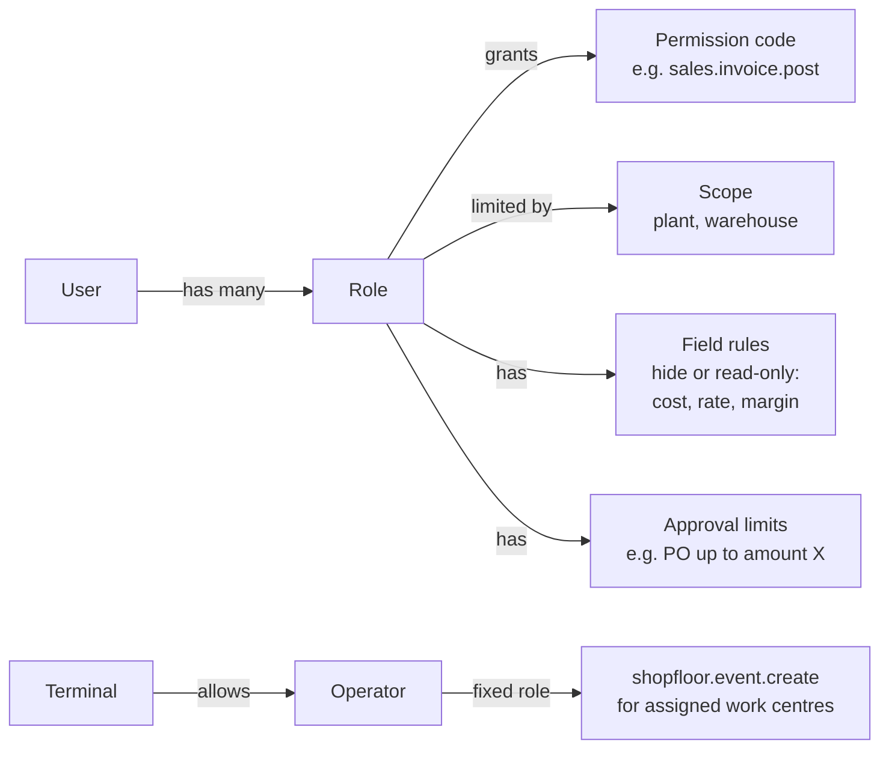
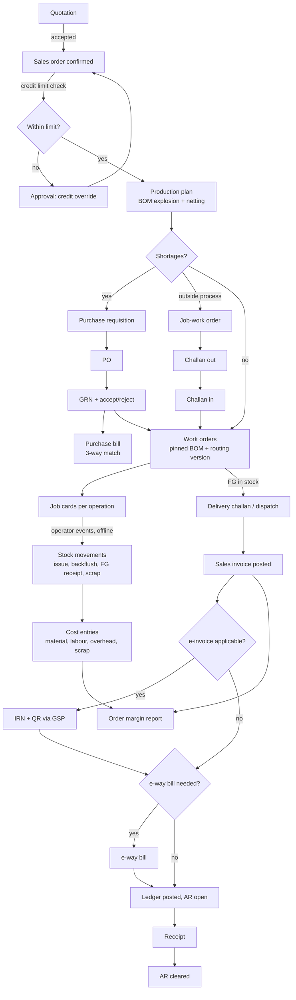
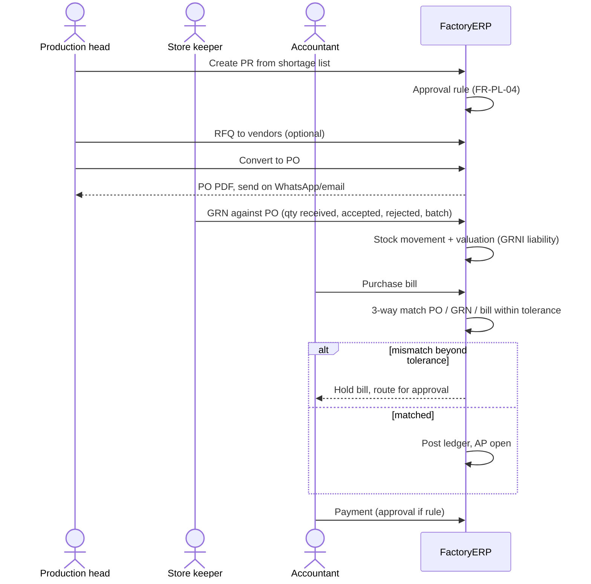
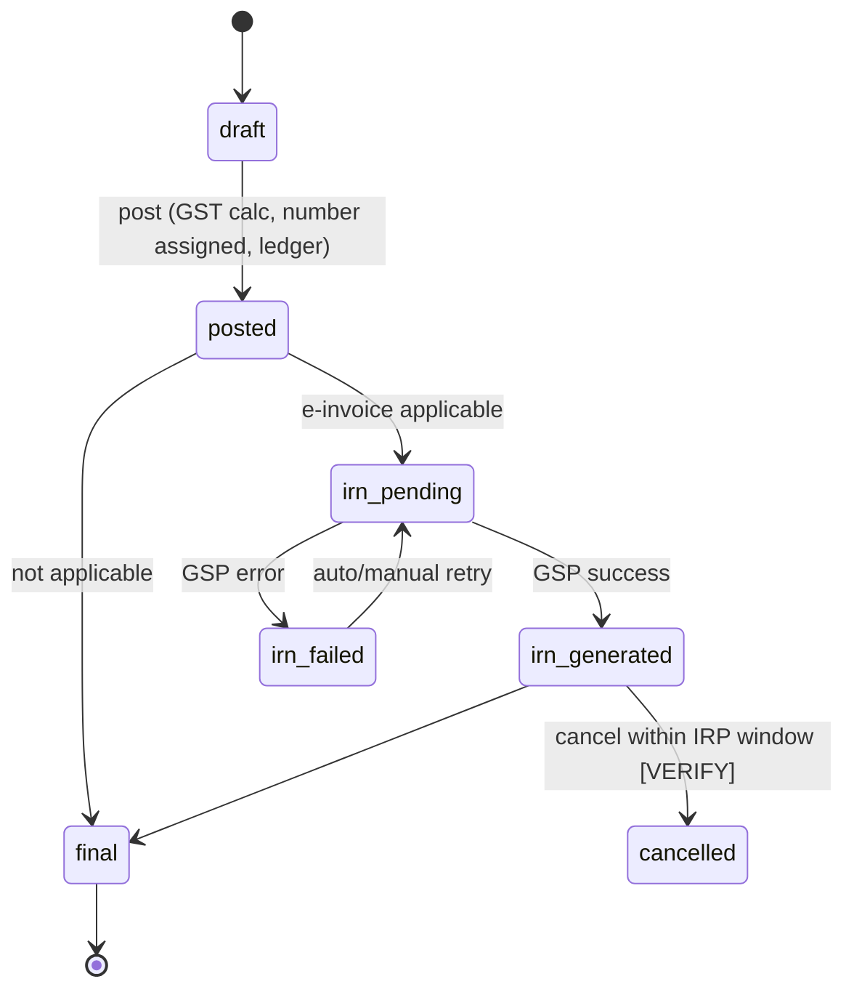
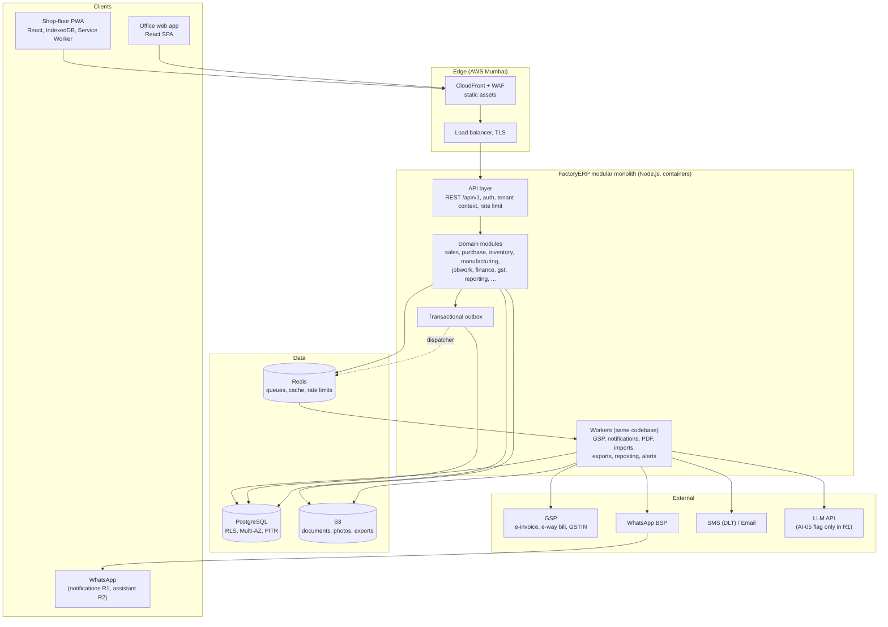
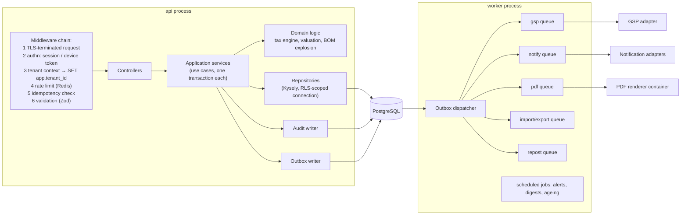
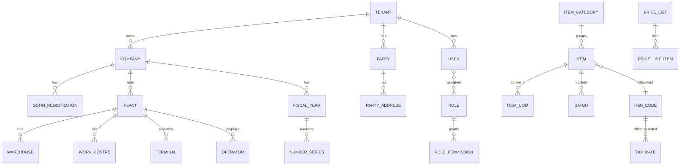
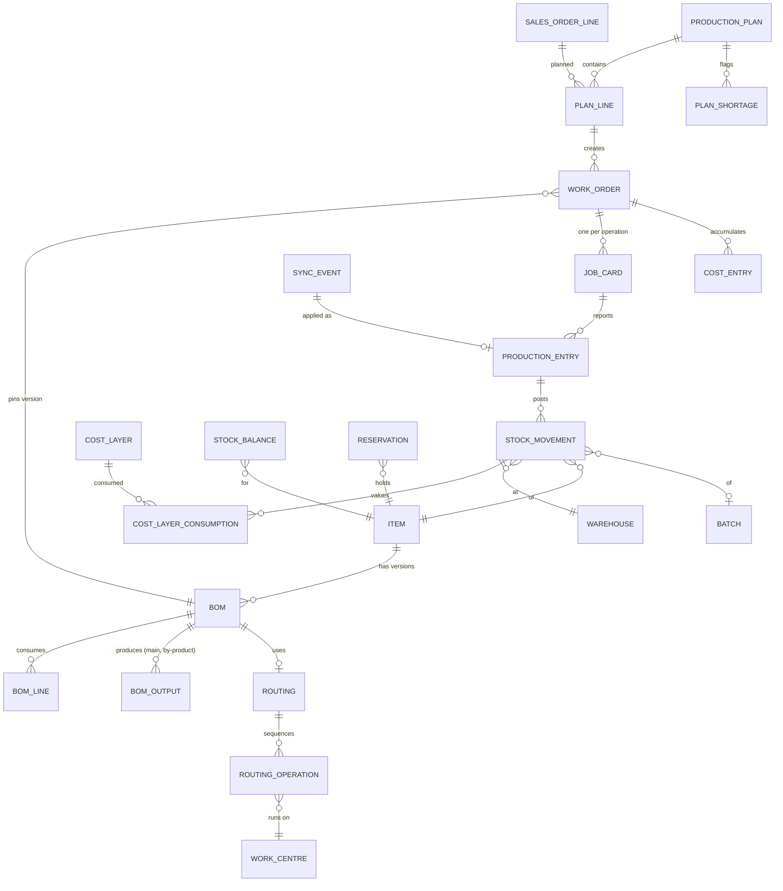
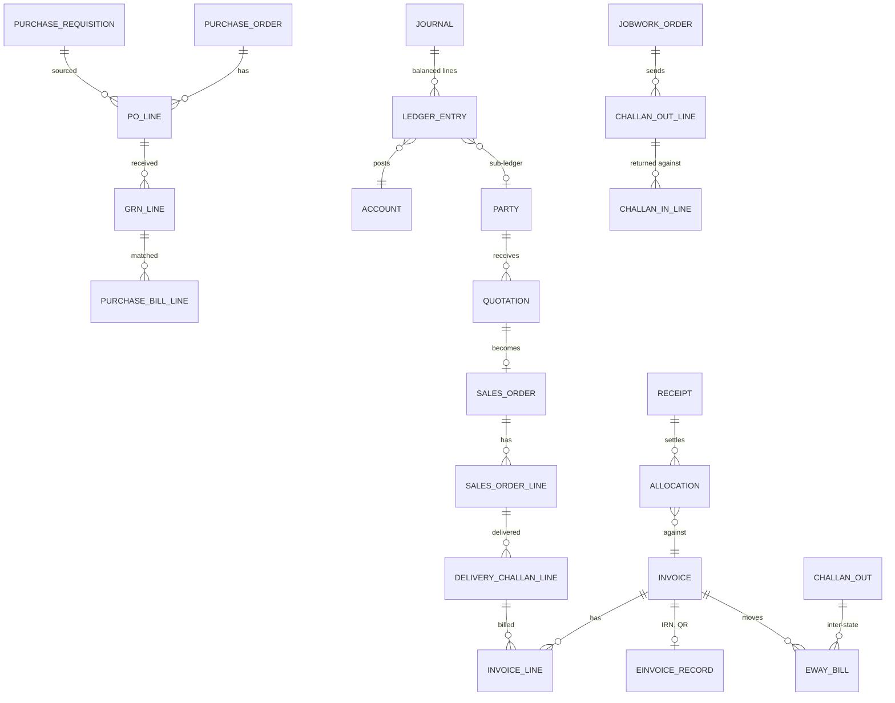

# FactoryERP — MVP Architecture and Engineering Specification

| | |
| --- | --- |
| **Version** | 1.0 (draft for review) |
| **Date** | 2 October 2026 |
| **Source** | `PRD_ Factory-First Cloud ERP for Indian SMEs.md` v1.0 (97 numbered requirements: 45 P0, 2 P0-P1, 32 P1, 2 P1-P2, 13 P2, 2 P2-P3, 1 P3) |
| **Scope** | R1 MVP (day 0-90) in full detail; R2/R3 as architectural hooks |

**Bottom line.** Build the R1 MVP as a **TypeScript modular monolith** on **one PostgreSQL database with row-level security**, an **offline-first operator PWA**, a **Redis-backed job queue fed by a transactional outbox**, and **bought** GST (GSP) and WhatsApp integrations, hosted in an **India AWS region**. Add an **internal double-entry ledger in R1** even though the chart-of-accounts UI is P1 — without it, invoices, payments, ageing, cash on the owner dashboard and Tally voucher export have nothing consistent to post to.

**Labels used throughout**

| Label | Meaning |
| --- | --- |
| **[PRD]** | Confirmed by the PRD (ID or section given) |
| **[GAP]** | Missing from the PRD but required for a P0 feature to work; needs product sign-off |
| **[REC]** | Recommendation of this spec; needs stakeholder approval |
| **[A]** | Assumption to validate |
| **[VERIFY]** | Regulatory statement to confirm with a CA before release (PRD §12 requires CA review each quarter) |

## Contents

1. MVP scope
2. MVP feature catalog (all P0)
3. Missing features added to the MVP
4. Suggested features
5. Users, roles and permissions
6. Core workflows and state machines
7. System architecture
8. Backend modules and boundaries
9. Multi-tenancy, provisioning and entitlements
10. Data model (ER)
11. Schema: key tables, constraints, indexes
12. Inventory, costing and accounting engine
13. Offline shop-floor sync
14. GST, e-invoice, e-way bill and job-work compliance
15. Integrations
16. API design
17. Security architecture and threat model
18. Non-functional requirements
19. Technology stack and architecture decisions (ADRs)
20. Testing and quality strategy
21. Infrastructure, DevOps and operations
22. 90-day build plan
23. Risks
24. Open questions
25. Appendix: traceability of deferred (P1-P3) requirements

---

## 1. MVP scope

R1 delivers **order-to-dispatch for one plant and one GSTIN, with native job-work, GST invoicing with e-invoice and e-way bill, an offline operator app, and Tally coexistence** [PRD §6].

**In R1 (day 0-90)**

- **Platform:** tenancy, RBAC, audit log, approvals, English + Hindi, imports, document templates, notifications.
- **Sales and purchase:** quotation → sales order → delivery challan → invoice; RFQ → PO → GRN → bill with 3-way match; auto purchase requisitions from shortages.
- **Inventory:** items with UoM and variants, multi-warehouse, batches, append-only stock ledger, FIFO + weighted average, reorder alerts, phone stock count.
- **Manufacturing:** multi-level BOM, routings, production plan with shortages, work orders and job cards, scrap/rework, basic order costing.
- **Job-work:** outward challans, receipts with process loss, ITC-04 data, time-limit alerts, inter-state e-way bills.
- **Finance and GST:** invoices, notes, receipts/payments, HSN validation, e-invoice via GSP with retry queue, e-way bill, ageing with WhatsApp reminders, Tally export.
- **Shop floor:** offline PWA, 3-tap entries, PIN / QR-badge login on shared devices.
- **Reports:** owner dashboard, standard reports with Excel/PDF export, order profitability.

**Deferred per PRD**

| Release | Window | Content |
| --- | --- | --- |
| R2 | Month 4-6 | Quality, maintenance, finite scheduling, barcode, workforce/piece-rate, AI features, CoA UI, GSTR-2B, TDS/TCS, bank reconciliation |
| R3 | Month 7-12 | Multi-plant/multi-GSTIN, OEE, public API and webhooks, e-commerce sync, advanced AI, security certification |
| Non-goals | — | Full HRMS, POS, e-commerce storefront, CRM automation, CAD/PLM, deep IoT/MES, advanced fixed assets, multi-country |

**Design rule: R1 must not block R2/R3.** Schema carries `company_id` and `plant_id` from day one; module APIs are written as internal REST so the P2 public API (FR-PL-11) exposes them rather than rewriting them; all state changes emit domain events so webhooks (P2) and AI features (P1) subscribe without touching posting code.

---

## 2. MVP feature catalog (all P0)

All **47** P0 and P0-P1 requirements are in R1. Each has one owning backend module (section 8).

| ID | Requirement | Module | MVP build note |
| --- | --- | --- | --- |
| FR-PL-01 | Multi-tenant SaaS, strict isolation | platform | Shared schema, `tenant_id` on every row, Postgres RLS + app scoping (§9) |
| FR-PL-02 | RBAC, module- and field-level permissions | identity | Permission codes per action; field rules mask fields in API and UI (§5) |
| FR-PL-03 | Immutable audit log: user, device, time | audit | Insert-only, monthly partitions, hash chain, written in the business transaction |
| FR-PL-04 | Configurable approvals (PO, discount, stock adjustment, payments) | workflow | Rule table: doc type + condition + approver role/limit; doc waits in `pending_approval` |
| FR-PL-05 | English + Hindi UI, framework for more | web, shopfloor | ICU message catalogs; Hindi names on masters [GAP G19] |
| FR-PL-06 | Excel/CSV import with error report; Tally master/voucher import | data-io | Staging tables, row-level validation, downloadable error file; Tally XML parser |
| FR-PL-07 | Branded templates: invoice, challan, PO, job card | documents | HTML/Handlebars templates → PDF by headless-Chromium worker |
| FR-PL-08 | WhatsApp, SMS, email, in-app notifications with preferences | notify | One notification service, channel adapters, per-user/per-event preferences |
| FR-FI-02 | Sales/purchase invoices, credit/debit notes, receipts, payments | finance | Each posts to internal double-entry ledger [REC, §12] |
| FR-FI-03 | GST invoicing: HSN 4/6 digit, tax calc, place of supply | gst | Tax engine with effective-dated rates; intra vs inter-state from place of supply |
| FR-FI-04 | e-Invoice IRN + QR via GSP; retry queue | gst | Outbox job, exponential backoff, visible status, manual retry (US-4) |
| FR-FI-05 | e-Way bill, incl. inter-state job-work | gst | From invoice or challan; threshold and mandatory cases in config |
| FR-FI-06 | AR/AP ageing; WhatsApp payment reminders | finance, notify | Ageing from open ledger items; reminder schedule per customer |
| FR-FI-07 | Tally export/sync (coexistence) | data-io | R1: Tally XML export of masters + vouchers; live connector R2 [REC] |
| FR-SP-01 | Customer/vendor masters, price lists, credit limits | parties | GSTIN validation via GSP; credit check at SO confirm |
| FR-SP-02 | Quotation → SO → delivery challan → invoice | sales | Partial delivery and invoicing per SO line |
| FR-SP-03 | RFQ, PO, GRN, purchase bill, 3-way match | purchase | Qty/rate match with tenant tolerances [GAP G14] |
| FR-SP-04 | Purchase requisition from shortage list | purchase | One-click PR from plan shortages (US-1) |
| FR-IN-01 | Item master: UoM conversions, categories, variants | inventory | Item-level UoM conversions; variants = items under a template |
| FR-IN-02 | Multi-warehouse, transfers, adjustments with reason codes | inventory | Adjustments routed through approvals |
| FR-IN-03 | Batch/lot; append-only stock ledger | inventory | `stock_movements` insert-only; balances updated in same transaction |
| FR-IN-04 | FIFO and weighted-average valuation | costing | Method per item, locked after first movement [REC] |
| FR-IN-05 | Reorder levels, low-stock alerts | inventory, notify | Checked on movement; daily digest |
| FR-IN-06 | Phone stock count with variance approval | inventory | Count sessions, blind-count option, variance over threshold → approval |
| FR-MF-01 | Multi-level BOM: versions, alternates, by-products | manufacturing | Versioned BOM; WO pins version |
| FR-MF-02 | Routings, operations, work centres, setup/run times | manufacturing | Routing versioned with BOM |
| FR-MF-03 | Production plan from SOs + shortage list | planning | Recursive explosion netted against stock, open POs, open WOs |
| FR-MF-04 | Work orders, job cards; manual + backflush issue | manufacturing | Job card per routing operation; backflush on good-qty report |
| FR-MF-05 | Scrap, rework, wastage with reason codes | manufacturing | Scrap to scrap warehouse at valuation; rework = rework job card |
| FR-MF-06 | Order costing: material, labour, overhead, scrap; std vs actual | costing | Cost entries per WO; labour from operator/work-centre rates [GAP G2] |
| FR-JW-01 | Job-work order + outward delivery challan | jobwork | Stock moves to a virtual warehouse per job-worker |
| FR-JW-02 | Receipt, process loss, job-worker charges | jobwork | Receipt lines link to challan lines; charges → purchase bill |
| FR-JW-03 | ITC-04 data (half-yearly > ₹5 cr, annual otherwise) | jobwork, gst | Report from challan ledger; frequency from tenant turnover band |
| FR-JW-04 | Alerts before 1-year / 3-year return limits | jobwork, notify | Daily job scans open challan lines; lead time configurable |
| FR-JW-05 | e-Way bill for inter-state job-work | gst | Mandatory regardless of value (PRD §12) |
| FR-SF-01 | Start/stop/pause, good/reject, reason in ≤3 taps | shopfloor | Job list per work centre; keypad; reason icons |
| FR-SF-02 | Offline-first, local store, auto sync, append-only | shopfloor, sync | IndexedDB event queue; idempotent ingest (§13) |
| FR-SF-03 | Icon/photo-first; Hindi + English | shopfloor | Item photos and reason icons from masters |
| FR-SF-04 | Low-end Android (2-3 GB RAM) PWA | shopfloor | Separate light bundle, no chart libs, < 300 KB JS gz target [REC] |
| FR-SF-07 | Shared-device login by PIN or QR badge | identity | Registered terminal + operator PIN; offline PIN check (§17) |
| FR-RP-01 | Owner dashboard | reporting | Daily aggregate tables updated by events |
| FR-RP-02 | Standard reports, Excel/PDF export | reporting | Async export jobs for large reports |
| FR-RP-03 | Order profitability + wastage (P0-P1) | reporting | Cost entries vs invoice value (US-5) |
| FR-IG-01 | GST e-invoice/e-way via GSP | integrations | Provider adapter behind one interface |
| FR-IG-02 | WhatsApp Business API | integrations | Via a BSP; approved templates only |
| FR-IG-03 | Tally import/export | integrations | Shared with FR-PL-06, FR-FI-07 |
| AI-05 | Smart import: auto-mapping, duplicates, errors (P0-P1) | data-io | R1: rule + fuzzy mapping; LLM suggestion behind tenant flag [REC] |

---

## 3. Missing features added to the MVP [GAP]

These are not P0 in the PRD, but at least one P0 requirement cannot work without them. Each needs product sign-off.

| # | Feature | Why the MVP needs it | Blocks | Proposed |
| --- | --- | --- | --- | --- |
| G1 | **Internal double-entry ledger + default chart of accounts** (no CoA editing UI) | Invoices, receipts, payments, ageing, cash on dashboard and Tally voucher export all need consistent postings; FR-FI-01 (CoA) is only P1 and Open Q2 is unresolved | FR-FI-02, FI-06, FI-07, RP-01 | P0 (backend only) |
| G2 | **Operator / worker master with labour rate** | PIN login needs an operator identity; order costing needs labour cost; employee master FR-HR-01 is P1 | FR-SF-07, MF-06 | P0 (light) |
| G3 | **Work-centre status from job events** (running / idle / down) | Owner dashboard shows "machine status" but machine master FR-MF-09 is P1 | FR-RP-01 | P0 (light) |
| G4 | **Tenant onboarding wizard + industry templates** | 14-day go-live goal and "template-driven onboarding" principle (§11) have no FR | Goal 2, US all | P0 |
| G5 | **Document number series per financial year and document type** | GST invoices need unique sequential numbers per FY [VERIFY]; challans, POs need series | FR-FI-03, JW-01 | P0 |
| G6 | **Financial year, periods and posting lock date** | Indian FY (Apr-Mar); stops back-dated postings into closed periods; costing reposts need a boundary | FR-FI-02, IN-04 | P0 |
| G7 | **Opening balances** (stock qty + value by batch, open AR/AP, open POs/SOs) | Every go-live starts mid-year from Tally/Excel | Go-live | P0 |
| G8 | **Plan entitlements and feature flags** | Pricing tiers (§13) gate job-work, costing, WhatsApp, Tally export, office-user count | §13 | P0 |
| G9 | **Terminal (device) management**: register, name, assign work centres, revoke, last-sync view | Shared-device login and offline sync need a trusted device identity | FR-SF-02, SF-07 | P0 |
| G10 | **Sync exception queue** | Offline events can be invalid on arrival (closed WO, over-reporting); they cannot be silently dropped | FR-SF-02 | P0 |
| G11 | **Negative-stock policy + material reservation** for WOs and SOs | Backflush and late offline syncs can drive stock below zero; plan netting needs reserved qty | FR-IN-03, MF-03, MF-04 | P0 |
| G12 | **Goods return flows**: sales return, purchase return / GRN rejection, job-work rejection | Credit/debit notes (FR-FI-02) exist but the goods side does not | FR-FI-02, IN-03 | P0 |
| G13 | **e-Invoice / e-way bill cancellation and amendment** | Wrong IRNs must be cancelled within the IRP window [VERIFY]; e-way bills need vehicle update | FR-FI-04, FI-05 | P0 |
| G14 | **GRN accept/reject quantity + 3-way-match tolerances** | §11 chain has Inspection between GRN and Bill but Quality (FR-QM-01) is P1 | FR-SP-03 | P0 (light) |
| G15 | **Reference masters**: reason codes, UoM, tax rates/HSN with effective dates, states, payment terms | Required by scrap, adjustments, tax engine | FR-IN-02, MF-05, FI-03 | P0 |
| G16 | **Full tenant export + offboarding** | NFR "full export in CSV/Excel at any time" has no FR | NFR data portability | P0 |
| G17 | **Internal support console** (tenant lookup, consented impersonation, audited) | Onboarding team (₹25-75k onboarding offer) needs to configure tenants | §13 onboarding | P0 |
| G18 | **Shift master** (shift name, times) | Production entries and dashboard roll up by shift; FR-HR-01 shifts are P1 | FR-SF-01, RP-01 | P0 (light) |
| G19 | **Localized master names** (Hindi item, operation, reason-code names) | Operator UI in Hindi is useless if item names are English-only | FR-SF-03, PL-05 | P0 |
| G20 | **Party GSTIN validation and state lookup** | Place of supply and e-invoice require valid GSTIN/state | FR-FI-03, FI-04 | P0 |
| G21 | **Subscription billing of tenants** (manual invoicing in R1) | Paid pilots from day one (§14) | GTM | P0 (manual) |

---

## 4. Suggested features [REC]

Recommendations beyond the PRD, ranked by value to the beachhead segment (job shops, fabrication, plastics, tier-2/3 auto components — PRD §4).

| # | Feature | Why | Suggested priority |
| --- | --- | --- | --- |
| S1 | **Inward job-work** (factory is the job-worker: customer-supplied material register, process, return with job-work charge invoice, separate stock ownership) | Job shops and tier-2/3 suppliers mostly *receive* material from OEMs; the PRD only covers outward subcontracting. Likely the most important missing capability for the beachhead | P0 or early R2 — **decide now** (Open Q) |
| S2 | **Customer delivery schedules / blanket orders** (monthly schedule, call-off releases) | Auto-component suppliers receive schedules, not one-off POs | P1 |
| S3 | **Gate entry and gate pass** (inward/outward register, returnable gate pass for dies/tools sent for repair) | Standard practice in Indian factories; links vehicle arrival to GRN and dispatch | P1 |
| S4 | **Mould / die / tool master with shot or stroke life** | Plastics and fabrication segments; extends FR-MF-09 | P1 |
| S5 | **Send documents on WhatsApp** (invoice, PO, challan PDF to party) | Cheap once FR-IG-02 exists; visible daily value | P0 |
| S6 | **Owner approval inbox on phone** (responsive web) | Persona "approves from phone"; WhatsApp-reply approvals (AI-02) are P1 | P0 |
| S7 | **Job card PDF with QR** | QR scanning (FR-SF-05) is P1, but printing the QR in R1 makes R2 scanning work on existing travellers | P0 |
| S8 | **Sandbox/training tenant per industry template** | Supports 14-day go-live and sub-1-hour operator training | P0 |
| S9 | **MSME payment-term tracking** (supplier Udyam status, due dates under MSMED Act / Income Tax s.43B(h)) [VERIFY] | Buyers of MSE suppliers face disallowance if paid late; also helps collections | P1 |
| S10 | **Dispatch planning board** (what ships today vs SO due dates) | Production head and owner both need "what will be late" | P1 |
| S11 | **Tally export reconciliation log** (what was exported, re-export, rejected vouchers) | Coexistence trust for CAs | P1 |
| S12 | **Last purchase rate and price history on PO** | Purchase control; feeds vendor rating FR-SP-06 | P1 |
| S13 | **Attachments and comments on any document** | Replaces WhatsApp side-threads; audit trail | P1 |
| S14 | **Per-tenant AI usage meter and limits** | Risk 9 (AI cost) needs enforcement before AI features ship | R2, with first AI feature |
| S15 | **In-app announcements and public status page** | Risk 6 (support overload) | P1 |

---

## 5. Users, roles and permissions

### 5.1 Roles

| Role | Persona [PRD §4] | Main capabilities | Login |
| --- | --- | --- | --- |
| Owner / Admin | Owner/MD | Everything; tenant settings, users, approvals, all reports, cost and margin | Web/mobile web, password + **mandatory 2FA** [PRD §10] |
| Production head | Production head | Plans, WOs, job cards, BOM/routing, scrap, production reports | Web |
| Store keeper | Store keeper | GRN, issues, transfers, counts, job-work challans; **no cost/rate fields** by default | Web/mobile web |
| Accountant | Accountant | Invoices, notes, receipts/payments, GST, e-invoice/e-way, Tally export | Web, 2FA |
| External CA | CA | Read-only finance + GST reports + exports | Web, 2FA, time-boxed access [REC] |
| Sales / Purchase user [A] | Not a PRD persona; implied by "5 office users" (§13) | Quotations, SOs, POs, RFQs | Web |
| Operator | Operator | Shop-floor app only: own job events | Terminal, PIN or QR badge |
| Platform support (internal) | — | Support console; impersonation only with tenant-granted, time-boxed consent | SSO + hardware 2FA |

### 5.2 Permission model



- **Permission codes** are `module.resource.action` (`inventory.adjustment.approve`). Seeded role templates per industry template; tenants clone and edit roles.
- **Field-level rules** [PRD FR-PL-02] are enforced on the server: the API serializer drops or masks restricted fields; the UI reads the same rule set to hide them. Never UI-only.
- **Scopes** hold `plant_id`/`warehouse_id` lists; R1 has one plant but scopes exist so multi-plant (P2) is configuration.
- **Segregation of duties** [REC]: the creator of a stock adjustment or payment cannot approve it, even as Owner, unless the tenant explicitly disables this.
- **Operators** never hold office permissions; an operator session is valid only on a registered terminal.

---

## 6. Core workflows and state machines

The PRD's core data chain [PRD §11] is the backbone:
`SalesOrder > ProductionPlan > WorkOrder > JobCard > StockMovement > CostEntry` · `PurchaseOrder > GRN > Inspection > Bill` · `JobWorkOrder > ChallanOut > ChallanIn > ITC-04` · `Invoice > IRN > EwayBill`.

### 6.1 Order-to-invoice (end to end)



**Workflow detail (critical steps)**

| Step | Trigger / actor | Business rules | Writes | Events |
| --- | --- | --- | --- | --- |
| Confirm SO | Sales user | Credit limit (FR-SP-01); price list; approval if discount > rule (FR-PL-04) | `sales_orders`, `sales_order_lines`, reservations [G11] | `SalesOrderConfirmed` |
| Generate plan | Production head (US-1) | Multi-level explosion of pinned BOM version; net against free stock, open POs, open WOs; alternates suggested not auto-applied | `production_plans`, `plan_lines`, `plan_shortages` | `PlanCreated` |
| Shortage → PR | Production head, one click (FR-SP-04) | One PR line per short item; suggested vendor = last vendor | `purchase_requisitions` | `PRCreated` |
| Release WO | Production head | WO carries SO line, BOM version, routing version (US-1) | `work_orders`, `job_cards`, material reservations | `WorkOrderReleased` |
| Report production | Operator, offline (US-2) | Append-only; corrections are new events; good + reject ≤ released qty + tolerance, else exception [G10] | `sync_events` → `production_entries`, `stock_movements`, `cost_entries` | `ProductionReported` |
| Dispatch | Store keeper | Only from available FG; batch picked FIFO by default | `delivery_challans`, `stock_movements` | `GoodsDispatched` |
| Post invoice | Accountant (US-4) | GST calc; HSN digits by turnover; invoice number from FY series; immutable once posted | `invoices`, `ledger_entries`, `einvoice_requests` | `InvoicePosted` |
| IRN | System job | Retry with backoff; status visible; never blocks printing of a draft, blocks final print until IRN when mandatory [REC] | `einvoice_requests` | `IrnGenerated` / `IrnFailed` |

### 6.2 Purchase to pay



### 6.3 Outward job-work (US-3)

```mermaid
sequenceDiagram
  actor SK as Store keeper
  participant ERP as FactoryERP
  participant GSP as GSP (e-way bill)
  SK->>ERP: Job-work order (job-worker, process, materials)
  SK->>ERP: Send material
  ERP->>ERP: Challan out from FY series; stock to virtual warehouse "JW: vendor"
  alt inter-state movement
    ERP->>GSP: Generate e-way bill (mandatory, any value)
    GSP-->>ERP: EWB number
  end
  ERP-->>SK: Print challan (with EWB)
  Note over ERP: Daily job: alert before 1-year (inputs) / 3-year (capital goods) limit
  SK->>ERP: Receipt: processed qty, returned scrap, process loss
  ERP->>ERP: Close challan lines (FIFO by challan date), move stock back, post loss
  SK->>ERP: Job-worker charges → purchase bill
  ERP->>ERP: ITC-04 data: open / closed challans per period
```

### 6.4 State machines

| Document | States | Notes |
| --- | --- | --- |
| Sales order | `draft → pending_approval → confirmed → partially_delivered → delivered → closed`; `cancelled` | Cancel only if nothing delivered; else short-close |
| Work order | `draft → released → in_progress → completed → closed`; `cancelled` | `closed` freezes cost; variance computed at close |
| Job card | `open → running ⇄ paused → completed` | States derived from operator events, never edited directly |
| Purchase order | `draft → pending_approval → approved → partially_received → received → closed` | Short-close allowed |
| GRN | `draft → posted` | Posted = immutable; reversal by return document [G12] |
| Job-work challan | `draft → issued → partially_received → closed`; `overdue` flag | Overdue = past legal time limit [PRD §12] |
| Invoice | `draft → posted → irn_pending → irn_generated`; `irn_failed` (retrying); `cancelled` | Posted invoices are never edited; cancellation or credit note only |
| e-Way bill | `pending → generated → (vehicle_updated) → expired / cancelled` | |
| Stock count | `open → counting → submitted → approved / rejected → posted` | Variance above threshold needs approval (FR-IN-06) |
| Sync event | `received → applied` or `received → exception → resolved (applied / voided)` | §13 |



---

## 7. System architecture

### 7.1 High level



**Why this shape** [PRD §11 + REC]
- **Modular monolith**, as the PRD states: one deployable, many modules with enforced boundaries. Load is small (500 tenants, 50k production events/day ≈ 0.6 events/s average) and ERP postings need cross-module ACID transactions (stock + cost + ledger in one commit). Microservices would turn those into sagas for no benefit.
- **Same codebase, two process types**: `api` and `worker` containers, scaled independently.
- **Event bus = transactional outbox in Postgres + Redis/BullMQ** rather than Kafka: events are written in the same transaction as the business change (no lost or phantom events), then dispatched to queues. Kafka/NATS only if R3 volume or IoT ingestion (FR-MF-13) demands it.

### 7.2 Component view (request and posting path)



### 7.3 Frontend architecture

**Office web app** (React SPA)
- **Structure:** feature folders mirroring backend modules (`features/sales`, `features/inventory`, ...), each with routes, API hooks, forms, components. Shared `ui` package (design system), shared `contracts` package (Zod schemas + generated API types) used by backend too.
- **Routing:** TanStack Router with route-level permission guards (`requires: ['sales.order.read']`); menu built from the user's permission set.
- **Server state:** TanStack Query; cache keys include tenant; optimistic updates only for non-posting actions.
- **Forms:** React Hook Form + Zod schemas from `contracts` (same validation as server); line-item grids with keyboard entry (accountants and store keepers are keyboard users coming from Tally).
- **Permissions in UI:** fields marked hidden/read-only from the server-delivered field-rule set; server still enforces.
- **i18n:** ICU messages (FormatJS / i18next), `en-IN` and `hi-IN`; Indian number grouping (`12,34,567.00`), `DD-MM-YYYY`, ₹ symbol, amount in words on invoices (Indian system: lakh/crore).
- **Errors:** RFC 9457 problem responses mapped to field errors or toasts; global error boundary reports to Sentry.
- **Responsive:** owner dashboard, approvals inbox and stock count are mobile-first; transaction entry is desktop-first.

**Shop-floor PWA** (separate bundle, see §13)
- Minimal dependencies, icon/photo-first, ≤3 taps (FR-SF-01), large touch targets, works on Android 8+ / 2 GB RAM (PRD §10).
- Local store: IndexedDB (via Dexie); Workbox service worker; background sync with foreground fallback (Background Sync API support varies on low-end Android).

---

## 8. Backend modules and boundaries

Each module owns its tables (prefix or schema-per-module, e.g. `inv.*`, `mfg.*`) and exposes a **public service interface**; other modules may not query its tables directly (enforced by lint rules / dependency-cruiser in CI). Reporting is the one read-only exception and reads via SQL views.

| Module | Owns | Depends on | Key domain logic |
| --- | --- | --- | --- |
| platform | tenants, companies, plants, settings, number series, FY, entitlements | — | Provisioning, feature flags, FY/lock dates |
| identity | users, roles, permissions, sessions, terminals, operators | platform | AuthN, 2FA, PIN, field rules |
| audit | audit_log | — (called by all) | Hash-chained append |
| workflow | approval rules, approval requests | identity | Rule evaluation, escalation |
| parties | customers, vendors, job-workers, addresses, GSTINs | gst (validation) | Credit limit |
| catalog | items, variants, UoM, categories, HSN link, price lists | gst | UoM conversion |
| inventory | warehouses, batches, stock_movements, stock_balances, reservations, counts | catalog, costing | Posting engine, negative-stock policy |
| costing | cost_layers, valuation, cost_entries, standard costs | inventory | FIFO/WA, reposting, cost roll-up |
| manufacturing | BOMs, routings, work centres, WOs, job cards, production entries | catalog, inventory, costing | Backflush, scrap, rework |
| planning | production plans, shortages | manufacturing, inventory, purchase | Multi-level explosion, netting |
| purchase | PR, RFQ, PO, GRN, purchase bills, returns | parties, inventory, finance | 3-way match |
| sales | quotations, SOs, delivery challans, sales returns | parties, inventory, finance | Pricing, credit check |
| jobwork | JW orders, challans out/in, ITC-04 data | inventory, gst, purchase | Challan matching, time-limit alerts |
| finance | ledger accounts, journals, invoices, notes, receipts, payments, ageing | gst | Double-entry posting |
| gst | tax rates, HSN, place-of-supply, e-invoice, e-way bill, GSTIN | integrations | Tax engine, threshold flags |
| shopfloor / sync | sync_events, device sequences, exceptions | manufacturing, identity | Idempotent ingest, ordering |
| notify | templates, preferences, outbound messages | integrations | Channel routing |
| documents | templates, rendered files | — | PDF rendering |
| data-io | imports, exports, Tally XML | most modules (via services) | Mapping, validation, AI-05 |
| reporting | daily aggregates, report definitions | reads views | Dashboard, exports |
| integrations | provider adapters (GSP, BSP, SMS, email, LLM) | — | Retries, circuit breakers, credentials |

**Transaction rule:** a use case runs in **one database transaction** spanning the modules it calls (in-process). Example — posting a production entry writes job-card progress, stock movements, balances, cost layers, cost entries, ledger entries, audit rows and outbox events atomically.

---

## 9. Multi-tenancy, provisioning and entitlements

### 9.1 Model comparison

| Model | Isolation | Cost / ops at 500 tenants | Migrations | Cross-tenant ops (support, analytics) | Verdict |
| --- | --- | --- | --- | --- | --- |
| Shared DB, shared schema + `tenant_id` + **RLS** | Logical; strong when RLS is enforced at DB level | Lowest; one pool | One migration | Easy | **Chosen for R1** [PRD §11] |
| Shared DB, schema per tenant | Better blast-radius | 500 schemas: catalog bloat, slow migrations | N migrations | Harder | Rejected |
| DB per tenant | Strongest | Highest; pool and backup per tenant | N migrations, orchestration | Hard | Only for future enterprise tier |
| Hybrid (shared + dedicated DB for large tenants) | Mixed | Medium | Two paths | Medium | **Future option (R3+)**: design keeps tenant data movable |

### 9.2 Isolation mechanics

- Every tenant-owned table has `tenant_id uuid not null`, part of every unique key and leading every index.
- RLS policy on every table: `using (tenant_id = current_setting('app.tenant_id')::uuid)` with `FORCE ROW LEVEL SECURITY`.
- The app connects as role `app_user` (no `BYPASSRLS`, not table owner). Each request/transaction runs `SET LOCAL app.tenant_id = ...` inside the transaction (safe with pooling via PgBouncer transaction mode).
- Migrations run as a separate owner role; support/analytics jobs use a distinct audited role.
- Composite foreign keys include `tenant_id` (e.g. `(tenant_id, item_id) references items(tenant_id, id)`) so a row can never point at another tenant's row.
- Redis keys, S3 object keys (`tenants/{tenant_id}/...`) and queue job payloads all carry the tenant; workers set the same DB context before touching data.
- **Isolation tests in CI**: automated suite creates two tenants and asserts every endpoint and every table returns zero cross-tenant rows (§20).

### 9.3 Organisation hierarchy

`Tenant (subscription) → Company (legal entity, PAN) → GSTIN registration → Plant → Warehouses / Work centres`.
R1 enforces one company, one GSTIN, one plant per tenant [PRD FR-PL-09], but tables are keyed so P2 multi-company/multi-plant/multi-GSTIN is a configuration change. Turnover band and e-invoice applicability are stored **per PAN/GSTIN** [PRD §12].

### 9.4 Tenant provisioning (onboarding) [GAP G4]


Templates are versioned JSON bundles applied by an idempotent seeding service, so onboarding staff can re-run steps.

### 9.5 Entitlements and feature flags [GAP G8]

- `plans` (Starter, Growth, Plus) → `plan_features` (feature key, limit). `tenant_entitlements` overrides per tenant (pilots, add-ons).
- Checked server-side in a guard: `requireFeature('jobwork')`, `limit('office_users', 5)`. Operators never count against user limits (per-plant pricing, PRD §13).
- **Conflict to resolve:** Tally export and WhatsApp are P0 product features but only in the Growth tier (§13). Recommend Starter gets Tally export (CA adoption, goal G4).

### 9.6 Backup, restore and offboarding

- Platform: RDS automated backups with point-in-time restore [PRD §10]; daily snapshots copied to a second India region.
- **Per-tenant restore** is not possible with PITR on a shared DB. Provide: (1) per-tenant logical export (nightly, encrypted, in S3) for tenant-level recovery from user error; (2) "undo" is through reversal documents, never row restores, for financial data.
- Offboarding: full CSV/Excel export [PRD §10], then soft-lock → hard delete after the retention window (accounting records retention to be confirmed [VERIFY]).

---

## 10. Data model (ER)

### 10.1 Platform, parties and catalog



### 10.2 Manufacturing, inventory and costing



### 10.3 Commercial, job-work and finance



---

## 11. Schema: key tables, constraints and indexes

### 11.1 Conventions

- PKs: `uuid` (UUIDv7, time-ordered for index locality; client-generated for offline events).
- Every tenant table: `tenant_id uuid not null`, `created_at`, `created_by`, `updated_at`, `updated_by`, `version int` (optimistic locking).
- **Money:** `numeric(18,2)` INR; **rates/prices:** `numeric(18,4)`; **quantities:** `numeric(18,4)`; **unit costs:** `numeric(20,6)`. Never floats. Application uses a decimal library (decimal.js / big.js).
- **Posted documents are immutable:** a trigger rejects `UPDATE`/`DELETE` when `status` is posted; changes go through reversal or credit/debit documents.
- **Soft delete** for masters only (`archived_at`); never for transactions.
- Document numbers: `(tenant_id, gstin_id, fiscal_year_id, series_code, number)` unique.

### 11.2 Critical tables (abridged DDL)

```sql
-- Append-only stock ledger: the single source of stock truth (FR-IN-03)
create table inv.stock_movements (
  tenant_id      uuid not null,
  id             uuid not null,
  plant_id       uuid not null,
  item_id        uuid not null,
  warehouse_id   uuid not null,
  batch_id       uuid,
  qty            numeric(18,4) not null check (qty <> 0),   -- +in / -out, stock UoM
  movement_type  text not null,       -- grn, issue, backflush, fg_receipt, scrap, transfer_out, transfer_in,
                                      -- jw_out, jw_in, adjustment, count_variance, dispatch, return, opening
  occurred_at    timestamptz not null, -- business time (may be offline device time)
  posted_at      timestamptz not null default now(),
  value          numeric(18,2),        -- filled by costing in the same txn
  source_doc_type text not null,
  source_doc_id  uuid not null,
  source_line_id uuid,
  reverses_id    uuid,                 -- corrections are new rows
  primary key (tenant_id, id),
  foreign key (tenant_id, item_id) references cat.items (tenant_id, id)
);
create index on inv.stock_movements (tenant_id, item_id, warehouse_id, occurred_at, id);
create index on inv.stock_movements (tenant_id, source_doc_type, source_doc_id);
-- grants: app_user has INSERT, SELECT only. No UPDATE / DELETE.

create table inv.stock_balances (       -- derived, updated in the same txn, rebuildable
  tenant_id uuid not null, item_id uuid not null, warehouse_id uuid not null,
  batch_id uuid not null default '00000000-0000-0000-0000-000000000000',
  qty_on_hand numeric(18,4) not null, qty_reserved numeric(18,4) not null default 0,
  value numeric(18,2) not null, avg_cost numeric(20,6),
  last_movement_id uuid not null,
  primary key (tenant_id, item_id, warehouse_id, batch_id)
);

create table cst.cost_layers (          -- FIFO layers (FR-IN-04)
  tenant_id uuid, id uuid, item_id uuid, warehouse_id uuid, batch_id uuid,
  in_movement_id uuid not null, occurred_at timestamptz not null,
  qty_in numeric(18,4) not null, qty_remaining numeric(18,4) not null check (qty_remaining >= 0),
  unit_cost numeric(20,6) not null,
  primary key (tenant_id, id)
);
create index on cst.cost_layers (tenant_id, item_id, warehouse_id, occurred_at) where qty_remaining > 0;

create table fin.ledger_entries (       -- double entry [GAP G1]
  tenant_id uuid, id uuid, journal_id uuid not null, account_id uuid not null,
  party_id uuid, debit numeric(18,2) not null default 0, credit numeric(18,2) not null default 0,
  posting_date date not null, fiscal_year_id uuid not null,
  source_doc_type text not null, source_doc_id uuid not null,
  check ((debit = 0) <> (credit = 0)),
  primary key (tenant_id, id)
);
-- deferred constraint trigger: sum(debit) = sum(credit) per journal_id at commit

create table sf.sync_events (           -- offline operator events (FR-SF-02)
  tenant_id uuid, event_id uuid,        -- client-generated UUIDv7
  terminal_id uuid not null, device_seq bigint not null,
  operator_id uuid not null, event_type text not null,  -- job_start, job_pause, job_stop, qty_report, correction
  job_card_id uuid not null, payload jsonb not null,
  device_time timestamptz not null, received_at timestamptz not null default now(),
  status text not null,                 -- applied | exception | voided
  exception_code text, applied_entry_id uuid,
  primary key (tenant_id, event_id),
  unique (tenant_id, terminal_id, device_seq)
);

create table aud.audit_log (            -- FR-PL-03, partitioned monthly
  tenant_id uuid, id bigint generated always as identity,
  at timestamptz not null default now(),
  actor_type text, actor_id uuid, terminal_id uuid, ip inet, user_agent text,
  action text not null,                 -- create, update, approve, delete, post, cancel, login, export
  entity_type text not null, entity_id uuid not null,
  before jsonb, after jsonb,
  prev_hash bytea, hash bytea not null  -- per-tenant hash chain (tamper evidence)
) partition by range (at);

create table plt.outbox (
  id bigint generated always as identity primary key,
  tenant_id uuid not null, event_type text not null, aggregate_id uuid not null,
  payload jsonb not null, created_at timestamptz default now(), dispatched_at timestamptz
);
create index on plt.outbox (created_at) where dispatched_at is null;
```

### 11.3 Other core tables (columns abbreviated)

| Table | Key columns | Constraints / notes |
| --- | --- | --- |
| `cat.items` | code, name, name_hi, category_id, item_type (raw, wip, fg, consumable, service), stock_uom, hsn_id, valuation_method, batch_tracked, reorder_level, reorder_qty, standard_cost, template_item_id | unique (tenant_id, code); `valuation_method` immutable after first movement |
| `cat.item_uoms` | item_id, uom, factor_to_stock | factor > 0 |
| `mfg.boms` | item_id, version, status (draft, active, obsolete), qty_per, routing_id | one active version per item (partial unique index) |
| `mfg.bom_lines` | bom_id, component_item_id, qty, uom, scrap_pct, alternate_group, issue_method (manual, backflush) | no cycles (checked on activation via recursive CTE) |
| `mfg.bom_outputs` | bom_id, item_id, qty, is_main, cost_share_pct | by-products [PRD FR-MF-01]; shares sum to 100 |
| `mfg.work_centres` | code, name, name_hi, labour_rate_hr, overhead_rate_hr, status [G3] | |
| `mfg.work_orders` | number, item_id, qty, bom_id, routing_id, so_line_id, plan_line_id, status, planned_start/end | bom_id/routing_id immutable after release |
| `mfg.job_cards` | work_order_id, operation_seq, work_centre_id, qty_planned, qty_good, qty_reject, status | quantities derived from production entries |
| `mfg.production_entries` | job_card_id, operator_id, shift_id, qty_good, qty_reject, reason_code_id, start_at, end_at, sync_event_id | immutable; corrections via `reverses_id` |
| `cst.cost_entries` | work_order_id, cost_type (material, labour, overhead, scrap, jobwork), amount, source | |
| `jw.challans_out` / `jw.challan_out_lines` | number, job_worker_id, is_interstate, eway_bill_id / item, qty, qty_returned, qty_loss, sent_at, due_by (1y/3y), goods_class (input, capital_goods) | `qty_returned + qty_loss ≤ qty` |
| `fin.invoices` | number, type (tax_invoice, credit_note, debit_note, bill_of_supply), party_id, place_of_supply_state, is_reverse_charge, taxable_value, cgst, sgst, igst, cess, round_off, total, status, irn_status | immutable when posted |
| `gst.einvoice_records` | invoice_id, irn, ack_no, ack_date, signed_qr, status, attempts, last_error | unique (tenant_id, irn) |
| `gst.tax_rates` | hsn_id, rate, cess, effective_from, effective_to | non-overlapping ranges (exclusion constraint) |
| `wf.approval_requests` | doc_type, doc_id, rule_id, requested_by, approver_role, status, decided_by, decided_at | creator ≠ approver [REC] |
| `idn.terminals` | plant_id, name, device_key_hash, work_centre_ids, last_sync_at, revoked_at | |
| `idn.operators` | code, name, name_hi, pin_hash, badge_secret_hash, labour_rate_hr, active | |

### 11.4 Indexing strategy

- Lead every index with `tenant_id`.
- Document lists: `(tenant_id, status, date desc)`; party lookups: `(tenant_id, party_id, date desc)`.
- Search: `pg_trgm` GIN on item/party code and name (incl. Hindi names). No separate search engine in R1.
- Partial indexes for hot "open" sets: open challan lines, unpaid invoices, `irn_status in ('pending','failed')`, undispatched outbox rows.
- Large append-only tables (`stock_movements`, `audit_log`, `sync_events`, `ledger_entries`) partitioned by month once volume warrants it; design PK/indexes to be partition-compatible from day one.

### 11.5 Transaction boundaries

| Use case | Single transaction contains |
| --- | --- |
| Post GRN | GRN status, stock movements, balances, cost layers, ledger (Inventory / GRNI), audit, outbox |
| Apply production event | sync_event status, production entry, job card qty, backflush issues, FG receipt, scrap, cost layers consumed/created, cost entries, ledger (WIP), audit, outbox |
| Post invoice | number allocation (row lock on series), invoice lines + tax, stock (if direct dispatch), ledger, AR item, einvoice_record (pending), outbox |
| Challan out | challan, stock transfer to JW warehouse, eway request (pending), audit, outbox |

Concurrency: `SELECT … FOR UPDATE` on `stock_balances` rows (sorted by key to avoid deadlocks) and on `number_series`. External calls (GSP, WhatsApp) **never** happen inside a DB transaction — they go through the outbox.

### 11.6 Migration and data lifecycle

- **Schema migrations:** forward-only SQL migrations, reviewed in PR, run by CI before deploy; expand → migrate → contract for breaking changes (zero downtime).
- **Customer data migration:** import via staging tables → validate → preview → commit; idempotent by external key (Tally GUID / Excel code). Opening balances posted as `opening` movements and an opening journal dated FY start or go-live date.
- **Retention:** accounting and GST records retained per statutory period [VERIFY — commonly cited as at least 72 months from the annual return due date under CGST rules]; audit log same; sync payloads 12 months then archived to S3 [REC]; exports and generated PDFs 90 days then regenerated on demand [REC].

---

## 12. Inventory, costing and accounting engine

### 12.1 Stock posting algorithm

1. Validate document and permissions; resolve UoM to stock UoM.
2. Lock affected `stock_balances` rows (ordered).
3. Apply **negative-stock policy** [G11]: per tenant (and overridable per warehouse) `block` (default for office documents) or `allow_with_exception` (default for offline shop-floor backflush, because the work physically happened). Negative balances raise an exception task for the store keeper.
4. Insert `stock_movements`; compute value via costing; update balances; write cost layers.
5. If `occurred_at` is earlier than the latest movement for that item/warehouse (backdated or late offline sync), enqueue a **repost job** for that item/warehouse from `occurred_at` forward. Reposting recalculates values of later outgoing movements and adjusts ledger values via correction journals; quantities never change.
6. Postings before the **lock date** [G6] are rejected.

### 12.2 Valuation [PRD FR-IN-04]

| Method | In | Out |
| --- | --- | --- |
| FIFO | New `cost_layer` at receipt unit cost | Consume oldest layers; value = Σ layer qty × unit cost |
| Weighted average (perpetual) | `avg = (value + in_value) / (qty + in_qty)` on balance | Out at current `avg_cost` |

- Method set per item (default from tenant setting), immutable after the first movement [REC].
- GRN unit cost = PO rate (excl. recoverable GST) + allocated landed cost (R2); updated when bill price differs (price variance to a variance account).
- Job-work: stock sent out keeps its value in the JW warehouse; receipt adds job-work charges to the processed item's value.

### 12.3 Order costing [PRD FR-MF-06, US-5]

| Cost element | Actual source (R1) | Standard source |
| --- | --- | --- |
| Material | Value of issue/backflush movements to the WO | BOM roll-up × standard cost |
| Labour | Job-card run time × operator labour rate, else work-centre labour rate [G2] | Routing setup + run time × rate |
| Overhead | Job-card run time × work-centre overhead rate | Routing time × rate |
| Scrap | Value of scrap movements net of scrap sale/recovery value | BOM `scrap_pct` |
| Job-work | Job-worker charges | Standard JW rate (if set) |

- WO close computes **variance = actual − standard** per element (basic in R1; full variance reports FR-MF-07 in R2).
- By-products: main output cost = total − by-product value (at standard or net realisable value), or split by `cost_share_pct` [REC: tenant choice].
- **Order margin** = Σ invoice taxable value for the SO − Σ WO actual costs linked to the SO.

### 12.4 Ledger postings [GAP G1, REC]

Default chart of accounts is seeded per template; the account mapping (which account each posting uses) is configuration.

| Event | Debit | Credit |
| --- | --- | --- |
| GRN posted | Inventory – raw material | GRN not invoiced (GRNI) |
| Purchase bill | GRNI; Input CGST/SGST/IGST | Vendor (AP) |
| Price difference on bill | Purchase price variance | GRNI (or reverse) |
| Material issue / backflush | WIP | Inventory – raw material |
| Labour / overhead absorbed | WIP | Labour absorbed; Overhead absorbed |
| FG receipt | Inventory – finished goods | WIP |
| Scrap | Inventory – scrap (at recoverable value); Scrap loss | WIP |
| Dispatch + sales invoice | Customer (AR); COGS | Sales; Output CGST/SGST/IGST; Inventory – FG |
| Credit note (sales return) | Sales returns; Output GST; Inventory | Customer; COGS |
| Receipt | Bank/Cash | Customer |
| Payment | Vendor | Bank/Cash |
| Job-work charges bill | WIP (or processed item inventory); Input GST | Job-worker (AP) |
| Stock adjustment / count variance | Inventory or Stock adjustment expense | the other side |

**Tally coexistence:** many SME Tally books do not run perpetual-inventory accounting. The Tally export therefore has two modes [REC]: *commercial vouchers only* (sales, purchase, receipts, payments, credit/debit notes — default) or *full* (incl. stock journals). Confirm per tenant with its CA.

---

## 13. Offline shop-floor sync [PRD FR-SF-02, US-2]

### 13.1 Sequence

```mermaid
sequenceDiagram
  actor OP as Operator
  participant PWA as Shop-floor PWA
  participant IDB as IndexedDB
  participant API as Sync API
  participant DB as PostgreSQL
  Note over PWA: Terminal registered once by admin (device key)
  PWA->>API: Pull masters delta (job cards for assigned work centres, items, reasons, operators+PIN hashes)
  API-->>PWA: Delta since cursor
  OP->>PWA: Enter PIN (verified locally against hash)
  OP->>PWA: Select job → Start
  PWA->>IDB: Append event {event_id UUIDv7, device_seq n, device_time, ...}
  PWA-->>OP: Confirmed locally (< 1 s), shown as "pending"
  OP->>PWA: Stop → good 120, reject 4 (reason icon)
  PWA->>IDB: Append event n+1
  Note over PWA,API: Connectivity returns (or periodic retry)
  PWA->>API: POST /sync/events [n, n+1] (terminal token, Idempotency by event_id)
  API->>DB: Insert sync_events ON CONFLICT (event_id) DO NOTHING
  API->>DB: Apply in device_seq order (one txn per event)
  alt valid
    DB-->>API: production entry, stock, cost, ledger
  else invalid (WO closed, qty over limit, gap in seq)
    DB-->>API: status = exception (kept, not dropped)
  end
  API-->>PWA: Per-event result {applied | exception | duplicate}, new cursor
  PWA->>IDB: Mark synced; keep exceptions visible to supervisor
```

### 13.2 Rules

- **Append-only, no edits** [US-2]: a correction is a new event with `reverses_event_id`; the server posts reversing movements.
- **Ordering:** per terminal by `device_seq` (gap-free counter persisted in IndexedDB). A gap holds later events until the missing one arrives or a timeout moves them to exceptions.
- **No duplicates:** `event_id` primary key + `(terminal_id, device_seq)` unique; the client resends until it gets a result.
- **Conflict-free by design** [PRD §10]: operators never edit shared records; they append facts. "Conflicts" become validation exceptions handled by the production head in the **sync exception queue** [G10] (apply anyway, void, or reassign to another job card).
- **Time:** `device_time` is the business time (bounded: not in future, not older than a configurable limit vs last sync); server stores `received_at`. Clock drift is measured on every sync and flagged.
- **8+ hours offline** [PRD §10]: capacity planning — an operator generating ~100 events/shift is a few KB; IndexedDB quota is not a constraint. Masters cache sized to assigned work centres only.
- **Storage loss protection:** request persistent storage (`navigator.storage.persist()`); the UI shows pending count and last-sync time so supervisors notice a device that has not synced.
- **App updates:** service worker updates only when the queue is empty or after sync, to avoid schema mismatches; events carry `schema_version`.
